<p align="center">
  
</p>

<h1 align="center">LEDsplay</h1>

<p align="center"><strong>Turn your piano into an interactive LED learning system.</strong></p>

<p align="center">
  <a href="https://ledsplay.lemonsqueezy.com/checkout"><strong>Get LEDsplay ($9, pay once)</strong></a> ·
  <a href="https://pawel.build/ledsplay/">Website</a> ·
  <a href="#installation">Install on Pi</a> ·
  <a href="#build-options">Build the hardware</a>
</p>


LEDsplay connects your digital piano to an LED strip via MIDI on a Raspberry Pi. Every key lights up in real time as you play. Learn songs, practice scales, play games - all controlled from a web app on your phone, tablet, or computer.

---

## Features

- 🎹 **Real-time LED visualization** - every key lights up instantly as you play
- 🎨 **LED animations** - Rainbow, Sparkle, Gradient, Bubble, Tetris, Police and more
- 🎵 **Song learning** - follow the lights, adjust tempo, practice hands separately, loop sections
- 🎼 **Sheet music display** - real notation in the browser with notes highlighted as you play
- 🎯 **Scales & note training** - all major scales with LED guides, 3 difficulty levels
- 🎮 **Piano games** - Reaction Game, Piano Battle (2-player), LED Keeper
- 📱 **Web interface** - control everything from your phone, tablet, or any browser

11 public domain demo songs included (Canon in D, Für Elise, Moonlight Sonata, and more). Upload your own MIDI/MusicXML files with the paid version.

---

## What it looks like

<p align="center">
  
</p>

<p align="center">
  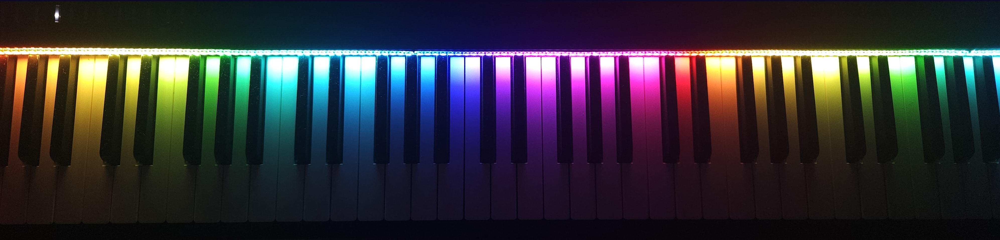
</p>

<table align="center"><tr>
<td valign="top">
  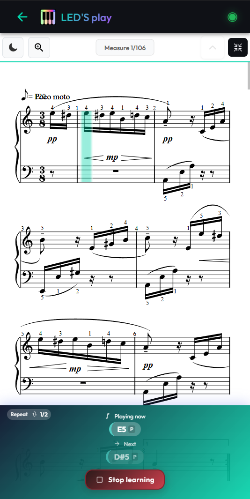<br>
  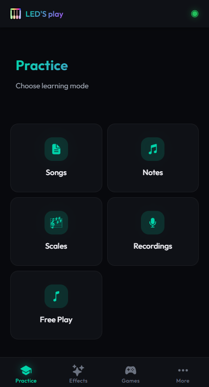
</td>
<td valign="top">
  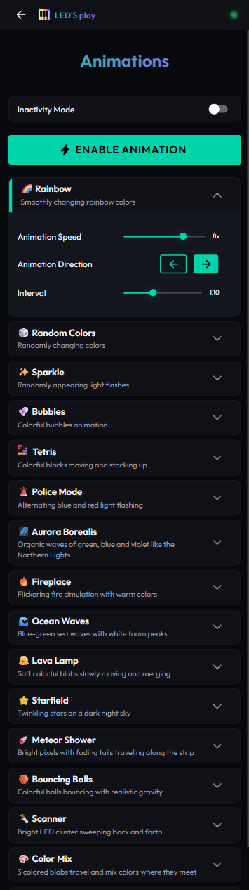
</td>
<td valign="top">
  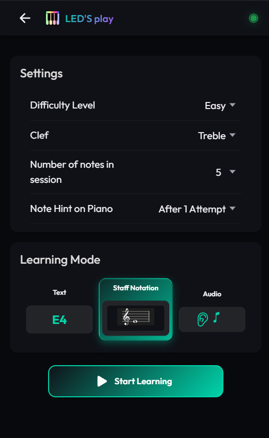<br>
  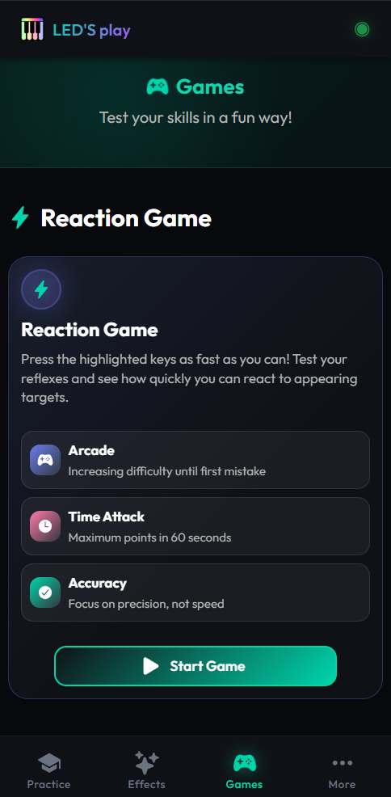
</td>
</tr></table>

<details>
<summary>More screenshots</summary>

### LED visualisation
<p>
  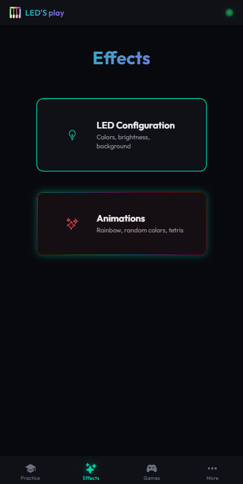
  &nbsp;
  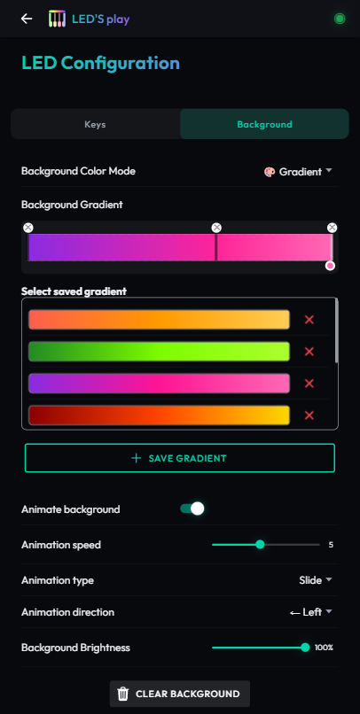
  &nbsp;
  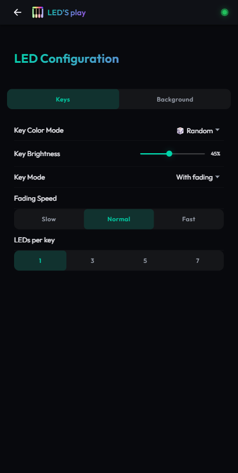
</p>

### Song learning & practice
<p>
  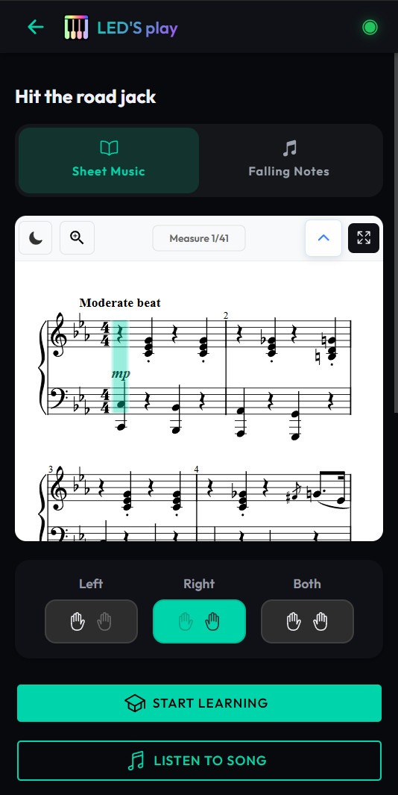
  &nbsp;
  
  &nbsp;
  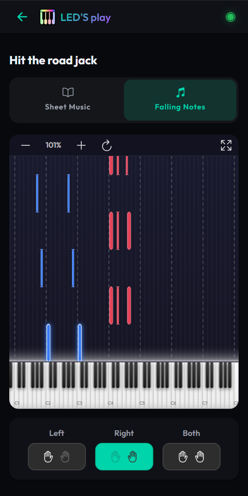
</p>

### Free piano
<p>
  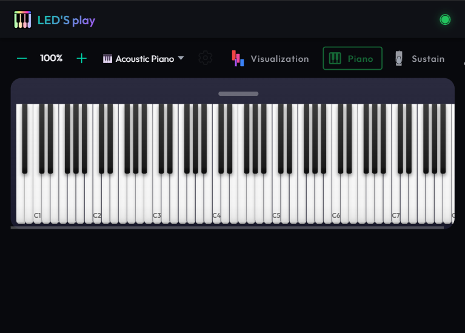
  &nbsp;
  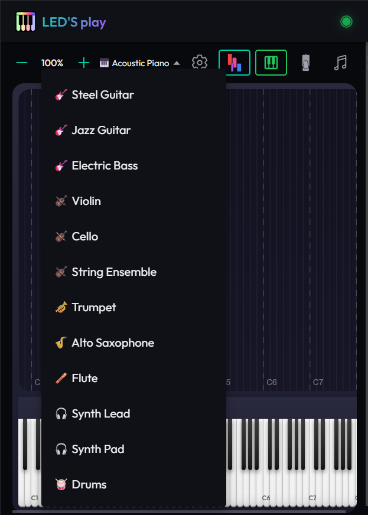
  &nbsp;
  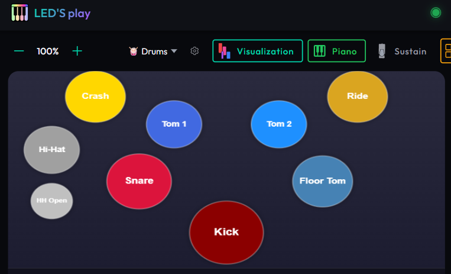
</p>

### Note learning & scales
<p>
  
  &nbsp;
  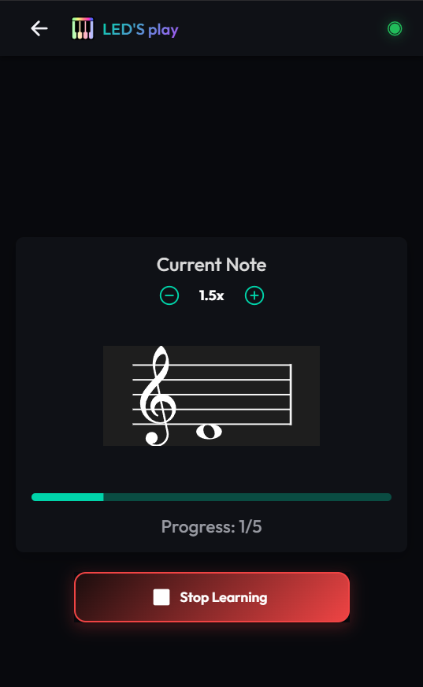
  &nbsp;
  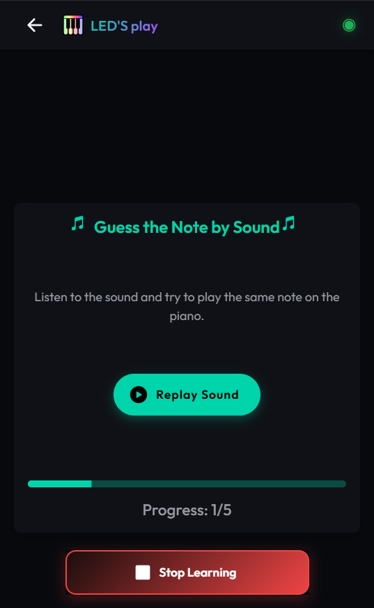
</p>
<p>
  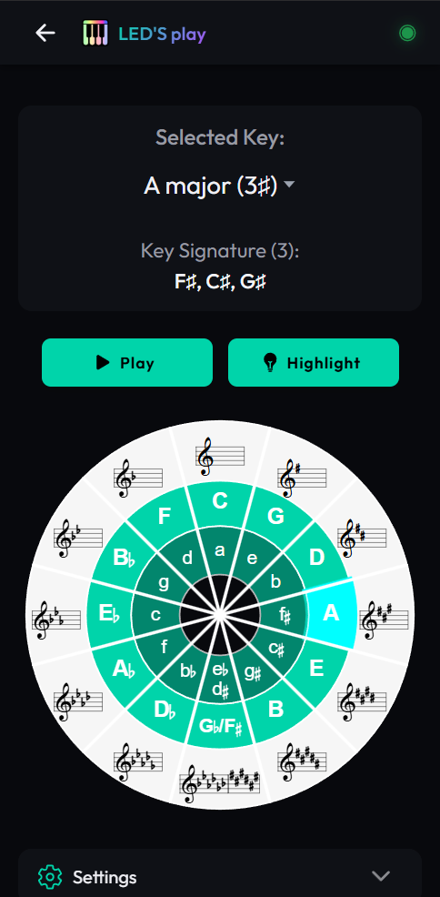
</p>

### Games
<p>
  
  &nbsp;
  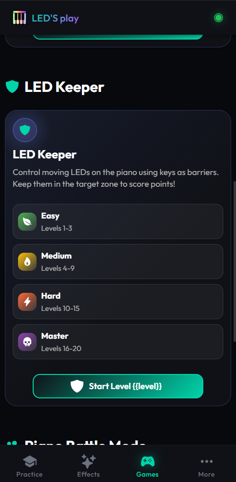
  &nbsp;
  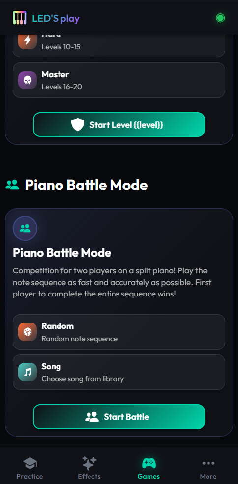
</p>

### System
<p>
  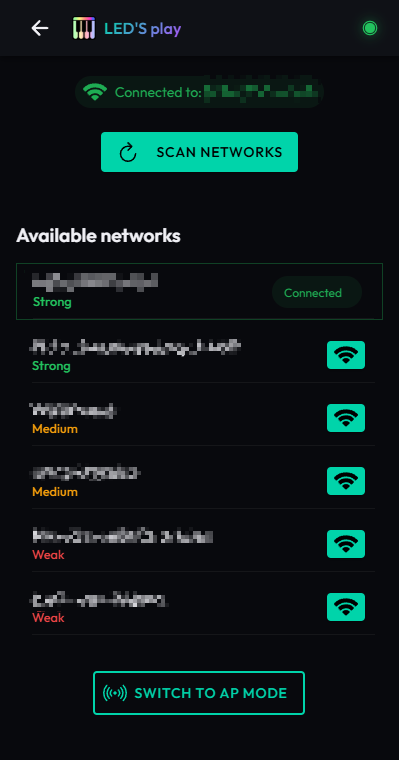
  &nbsp;
  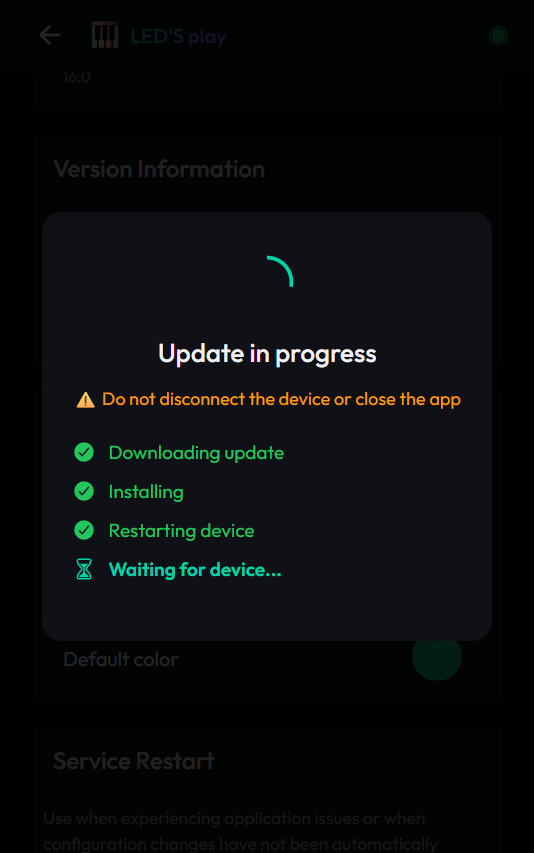
  &nbsp;
  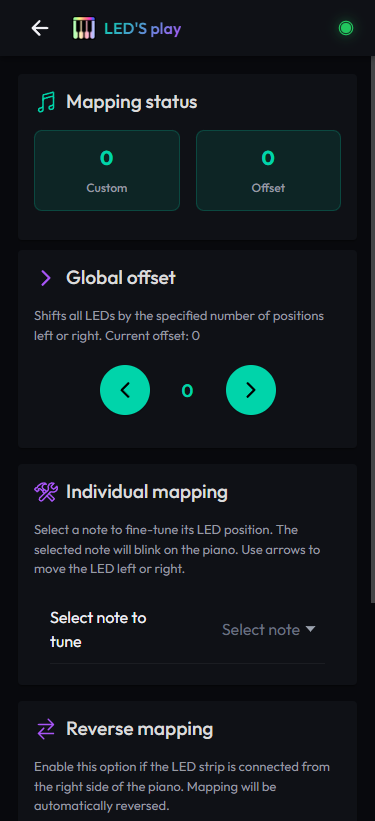
</p>

</details>

---

## Free vs Paid

The free version works forever - no time limit, no account needed.

| | Free | Paid ($9, one-time) |
|---|:---:|:---:|
| Real-time key lighting | ✅ | ✅ |
| All LED animations | ✅ | ✅ |
| 11 demo songs | ✅ | ✅ |
| Upload your own songs (MIDI/MusicXML) | ❌ | ✅ |
| Sheet music display | ❌ | ✅ |
| Scale & note learning | ❌ | ✅ |
| Piano games | ❌ | ✅ |
| MIDI recording & playback | ❌ | ✅ |
| PCB Gerber files & 3D case STLs ([reference only](#build-with-custom-pcb-and-3d-case)) | ❌ | ✅ |
| All future features | ❌ | ✅ |

**No subscription.** Pay once, own it forever. No monthly fees, no cloud dependency - LEDsplay runs entirely on your Raspberry Pi. Up to 3 devices per license.

**[→ Get LEDsplay - $9 one-time](https://ledsplay.lemonsqueezy.com/checkout)**

Not sure yet? [Install the free version](#installation) first - it includes a full 14-day trial of every paid feature, no credit card needed, so you can try everything before deciding to buy.

---

## What you need

### Hardware

| Part | Details | Est. cost |
|------|---------|-----------|
| Raspberry Pi | **Zero 2W** (fits the custom PCB/case) or **4B** (standalone setup) - both tested. **Pi 5** should also work but hasn't been tested yet | $15 *(Zero 2W)* |
| microSD card | 8 GB or larger, Class 10 / A1 recommended | $5 |
| WS2812B LED strip | 144 LEDs/m, individually addressable (look for *"2 m in a single piece"* if you don't want to solder) | $8–15 |
| Digital piano | Any with **USB MIDI** output (tested on Roland FP-30) | - |
| USB cable | Piano side: usually USB-B. Pi side: micro USB (Zero 2W) or USB-A (Pi 4/5) | $3–5 |
| Power supply | **5 V, 3 A minimum** - one supply for both the Pi and the LED strip. micro USB for the DIY build (Pi Zero 2W) or USB-C for the custom PCB - see [Power & brightness](#power--brightness) | $5–15 |
| Power wiring *(DIY build)* | 3-pin JST-SM pigtail that mates with the strip's connector (many strips come with one), red/black wire ≥ 0.33 mm² (22 AWG), solder | $2–5 |
| Other / optional | Jumper wires to connect components to the Pi (female end for the GPIO header); heat-shrink tubing; screws **or** glue to join the case halves; double-sided tape or velcro to attach the case to the piano | $1–5 |

**Estimated total (without piano): $40–65** with a Pi Zero 2W and components you don't already have.

---

## Build options

LEDsplay runs the same software on any supported Pi. The recommended way to build it is plain wiring: the signal wires go straight into the GPIO header, and the LED strip takes its power from the supply cable, so its current never flows through the Pi. Cheap, and no special parts needed.

A custom PCB and 3D case also exist as an alternative for a cleaner build, but ordering them from a manufacturer isn't cost-effective at low quantities - see the note below if you're curious.

Works with any digital piano that has USB MIDI output. Primary testing is done on a **Roland FP-30**.

---

### DIY build

> **A note from me:** I'm not an electronics engineer. Earlier versions of this guide had the strip's power wires on the Pi's 5V and GND pins. That wiring ran for over a year without issues, but it sends the whole LED current through the Pi's micro-USB socket and board. The wiring below takes the strip's power from the supply cable instead. If you have ideas for improvements, I'd love to hear them - [open an issue](https://github.com/PabloCSScobar/ledsplay/issues).
>
> The **custom PCB** (see the other build below) was designed by a professional hardware engineer.

You can put this build together your own way - design your own enclosure or adapt a stock Pi case to fit your needs. The two status LEDs and the standby button are completely optional - the device and the app run perfectly without them.

On the GPIO header, no soldering is needed: use female Dupont jumpers, or wrap each wire around its pin and secure it with heat-shrink tubing. Taking the strip's power from the supply cable takes two solder joints. The standby button usually needs its wires soldered to the contacts, unless you pick a model with screw terminals or a pre-wired breakout board.

<p align="center">
  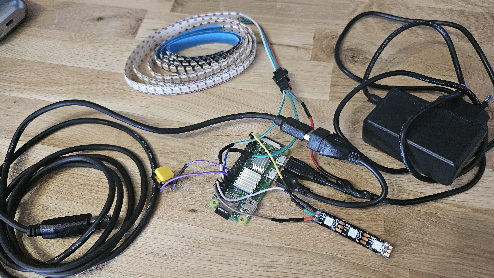
</p>

<p align="center"><em>Everything laid out: Raspberry Pi Zero 2W, WS2812B strip, USB MIDI cable, power supply. Optional: 2 status LEDs and a standby button.</em></p>

#### Wiring

One 5 V 3 A micro-USB supply powers both the Pi and the LED strip. The strip takes its power from the supply cable before the micro-USB plug: its +5 V and GND wires are soldered to the cable's + and − wires. From there, the same cable goes on to the Pi's **PWR IN** and carries only the Pi's own current. The only wire between the strip and the Pi is the data wire.

<p align="center">
  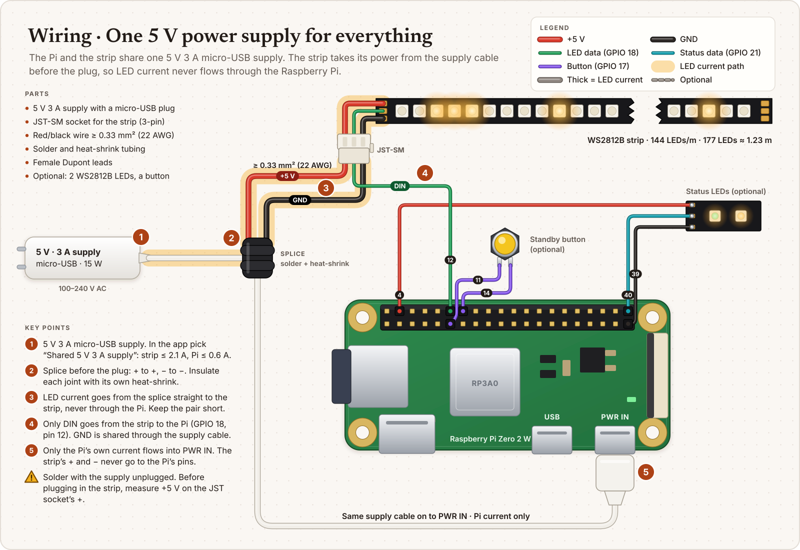
</p>

**Raspberry Pi pins:**

| Pi pin | Signal | Connect to |
|--------|--------|------------|
| **12** (GPIO 18) | LED strip data | strip DIN |
| **40** (GPIO 21) | status LEDs data *(optional)* | DIN of LED #1, then LED #1 DOUT → LED #2 DIN |
| **4** (5V) | status LEDs power *(optional)* | +5V of both status LEDs |
| **39** (GND) | status LEDs ground *(optional)* | GND of both status LEDs |
| **11** (GPIO 17) | standby button *(optional)* | one leg of the button |
| **14** (GND) | standby button *(optional)* | other leg of the button |

The strip's +5V and GND don't go to any Pi pin.

**Strip power** - from the supply cable:

| Goes to | Wire | Notes |
|---------|------|-------|
| LED strip +5 V / GND | red/black ≥ 0.33 mm² (22 AWG), as short as practical | solder each wire to its conductor in the supply cable, + to +, − to −, and insulate each joint with its own heat-shrink tube |
| Pi **PWR IN** | the rest of the supply cable | carries only the Pi's current, 0.6 A at most |

- **Splice:** wire colours inside supply cables aren't standard - tell + from − with a multimeter, not by colour.
- **Supply cable:** the part between the supply and the splice carries the strip's and the Pi's current together, up to 2.7 A. If it's thin or long, the voltage drops at both - see [Before you power on](#before-you-power-on).
- **JST connector:** the strip's JST-SM contacts are rated 3 A. At the default power setting the strip draws at most 2.1 A, with the 4 A setting up to 3 A. If your strip has separate red/black power leads next to the connector, connect the power pair there and use the JST for data only.
- **Pi 4B:** use a USB-C supply and take the strip's power from its cable the same way. For the power setting, see [Power & brightness](#power--brightness).

Then plug your piano into the Pi's USB data port (on the Zero 2W, the micro-USB port marked **USB**, not **PWR IN**).

**Upgrading from the old wiring:** earlier versions of this guide had the strip's +5V and GND on the Pi's pins. With the supply unplugged:

1. Solder the strip's power pair into the supply cable as shown above.
2. Take the strip's +5V and GND off the Pi's pins and keep the data wire on GPIO 18 (pin 12). Don't add a second GND wire between the strip and the Pi: the supply cable already joins the grounds, and a second wire would send part of the strip's current through the Pi again.
3. In the app, pick **Shared 5 V 3 A supply** in **Settings → LED strip power**.

#### Before you power on

Solder and rewire only with the supply unplugged. Don't probe the GPIO header directly - a slipped probe can short a neighbouring pin. To measure the Pi's 5 V, plug two Dupont jumpers into pins 2 (5V) and 6 (GND) for a moment and measure at their free ends.

1. **Shorts** (supply unplugged, continuity mode): + and − in the JST socket must not beep.
2. **Polarity** (strip unplugged, supply plugged in): 5.0–5.25 V between + and − in the strip's JST socket. A negative reading means + and − are swapped.
3. **Common ground** (supply and strip still unplugged): − in the JST socket and Pi pin 6 beep while the micro-USB plug is in **PWR IN**, and stop when you pull it out. If they still beep without the plug, a second GND wire runs between the strip and the Pi - remove it.
4. **Idle:** plug everything in and switch on. With the strip dark: about 5 V at the strip input and at the Pi.
5. **Full load:** a white background with its brightness slider at maximum (the current limit holds the strip at 2.1 A). At least 4.75 V must stay at the strip input and at the Pi, and the Pi must not reboot. If the voltage is lower, the supply cable between the supply and the splice is usually too thin or too long: move the splice closer to the supply or use a thicker cable, or for now pick a lower setting in the app.
6. **Heat:** after 10 minutes of a bright effect, touch the splice, the JST connector and the micro-USB plug. Warm is fine; hot means a bad contact or a wire that's too thin.

<p align="center">
  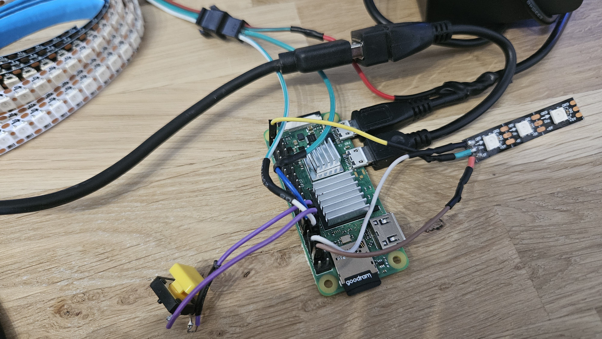
</p>

<p align="center"><em>Close-up of the GPIO header with all wires connected - LED strip, two status LEDs, and the standby button.</em></p>

**Build examples**

A few different ways the DIY build can be put together:

<table align="center">
<tr>
<td valign="top" width="50%">
  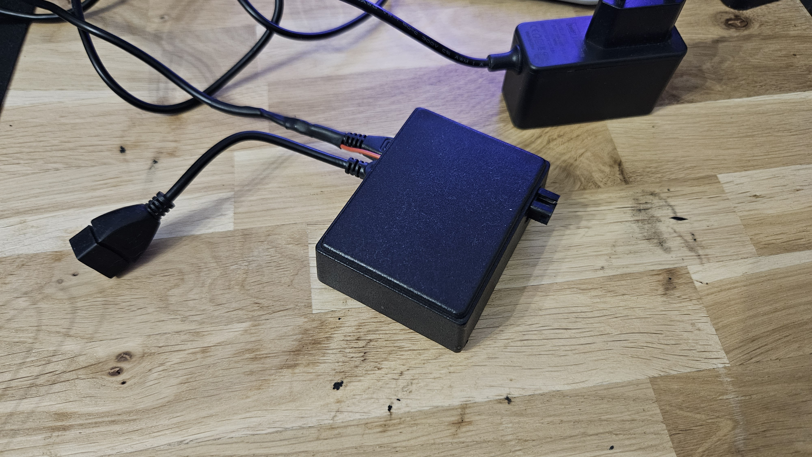<br>
  <em>Pi Zero 2W in a generic plastic enclosure - holes drilled in the sides for the LED strip socket, USB MIDI, and power.</em>
</td>
<td valign="top" width="50%">
  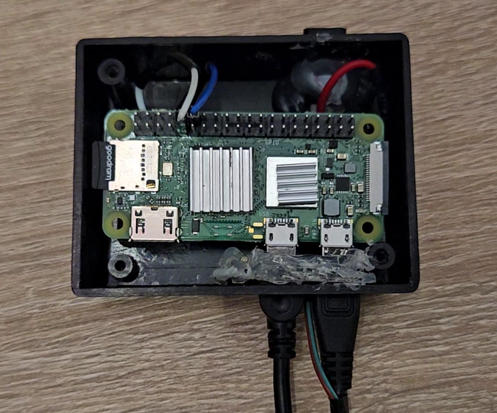<br>
  <em>Inside view of the same stock case - just the Pi, no PCB needed.</em>
</td>
</tr>
<tr>
<td valign="top" width="50%">
  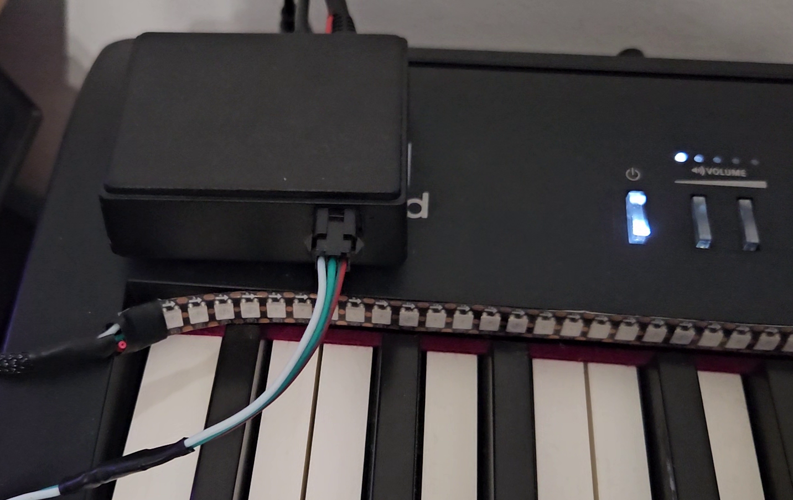<br>
  <em>The stock-case build mounted on the piano next to the LED strip.</em>
</td>
<td valign="top" width="50%">
  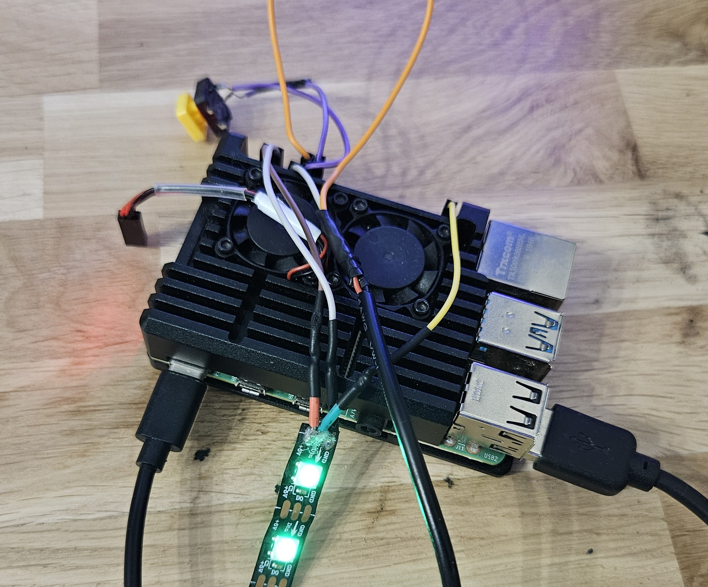<br>
  <em>Raspberry Pi 4B variant with all optional extras connected: status LEDs, standby button, LED strip.</em>
</td>
</tr>
</table>

---

### Build with custom PCB and 3D case

A custom PCB and 3D-printed case sized for the Pi Zero 2W. Skips almost all of the wiring work - the only thing you need to do is swap the LED strip's end connector for a 3-pin JST plug so it fits the PCB socket. Everything else just snaps together: Pi onto the PCB, PCB into the case, lid on top.

> **PCB Gerber files and 3D case STLs** are included with the paid version. See [Free vs Paid](#free-vs-paid).

PCB Gerber files and case STLs are included mainly as a reference if you want to build your own version. Ordering a single assembled PCB from a manufacturer is not cost-effective due to fixed setup fees - DIY wiring (see above) is the simplest and cheapest way to build this.

<p align="center">
  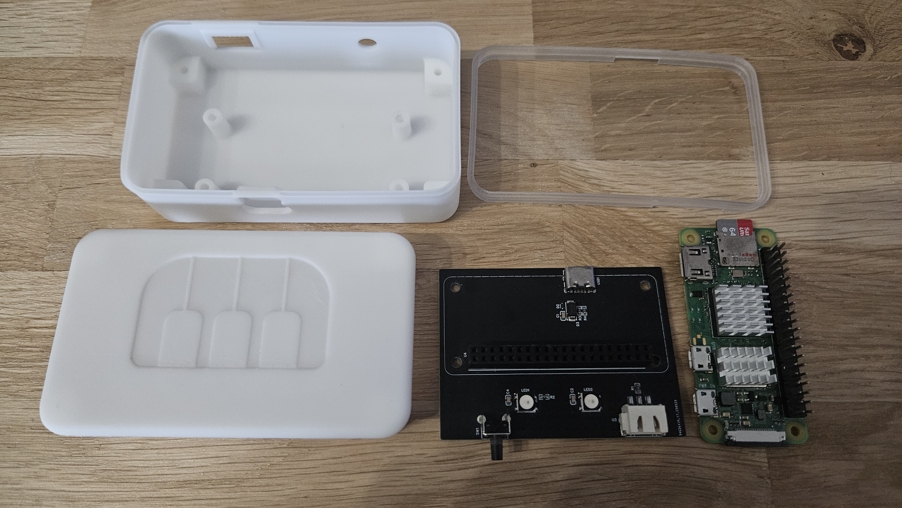
</p>

<p align="center"><em>The pieces: 3D-printed case parts, custom PCB, Raspberry Pi Zero 2W.</em></p>

<table align="center"><tr>
<td valign="top">
  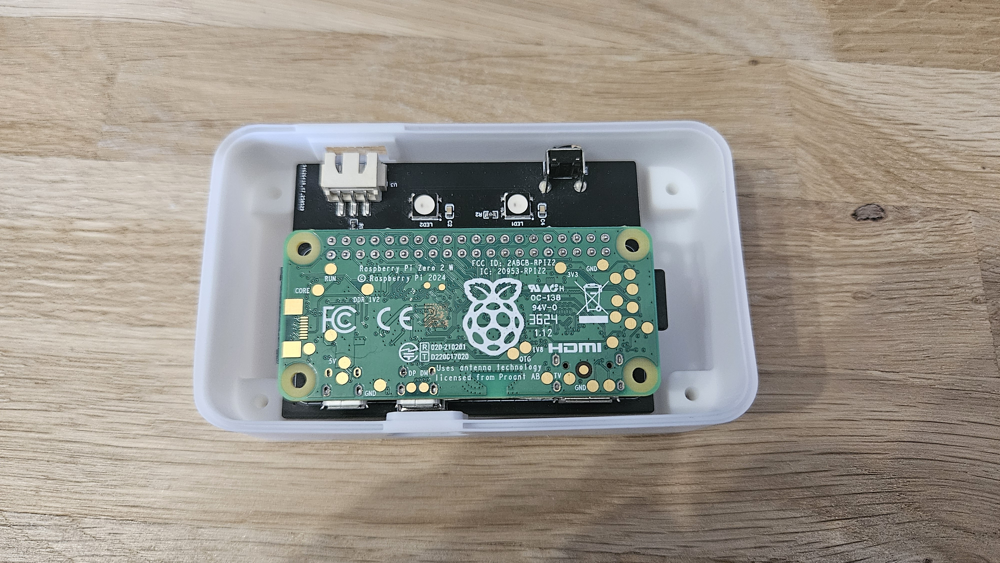<br>
  <em>Pi snaps into the PCB, which sits inside the case.</em>
</td>
<td valign="top">
  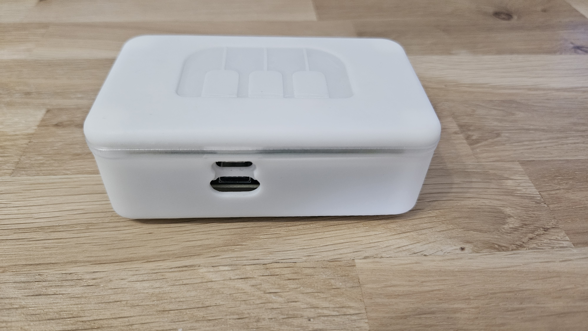<br>
  <em>Closed case with a piano-key relief on the lid.</em>
</td>
</tr></table>

<p align="center">
  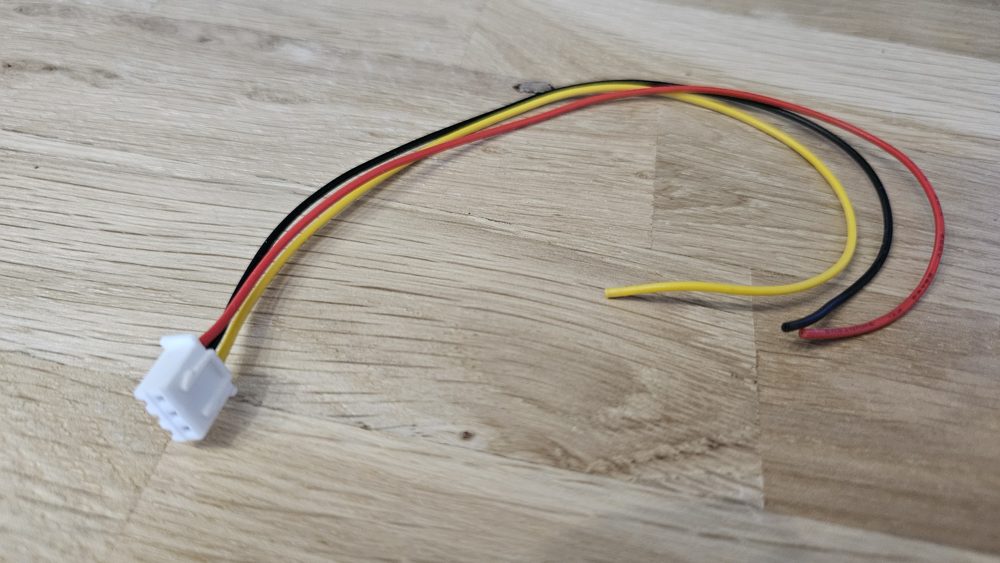
</p>

<p align="center"><em>To connect the LED strip to the custom PCB, its end has to be terminated with a 3-pin JST plug.</em></p>

<p align="center">
  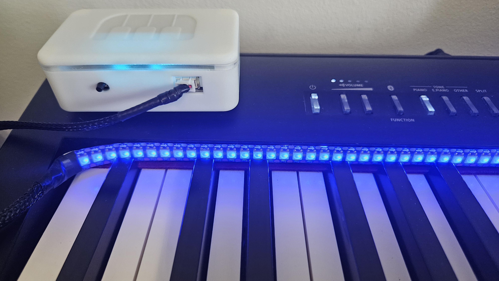
</p>

<p align="center"><em>Installed on a Roland FP-30 - LED strip running across the keys.</em></p>

---

## Installation

There are two ways to install LEDsplay:

---

### Option 1 - Script install
Install on a Raspberry Pi Zero 2W or 4B - both tested. Pi 5 hasn't been tested yet but should work (see [What you need](#what-you-need)).

**1. Flash Raspberry Pi OS Lite (32-bit)** onto a microSD card - on every Pi model, including 4B/5. You can use [Raspberry Pi Imager](https://www.raspberrypi.com/software/) or any other tool; in Imager it's under **Raspberry Pi OS (other) → Raspberry Pi OS Lite (32-bit)**.

> **Use the current 32-bit release (Debian 13 "Trixie").** LEDsplay won't start on the 64-bit OS or on the older "Legacy" (Bookworm) release.

If using Raspberry Pi Imager, open the settings and configure:
- **Hostname:** `ledsplay` - this lets you reach the Pi at `ledsplay.local`
- **Username:** `pi`
- **WiFi credentials** - so the Pi connects to your network on first boot
- **Enable SSH** - so you can log in remotely without a monitor

**2. Boot the Pi and connect via SSH:**

```bash
ssh pi@ledsplay.local
# or use the IP address assigned by your router
```

If SSH shows `REMOTE HOST IDENTIFICATION HAS CHANGED` (you flashed this card before), run `ssh-keygen -R ledsplay.local` and connect again.

**3. Run the setup script:**

```bash
curl -fsSL https://raw.githubusercontent.com/PabloCSScobar/ledsplay/main/setup.sh | sudo bash
```

This downloads the latest release from GitHub, installs all dependencies, and configures the system. **On Raspberry Pi Zero 2W, setup takes about 5 minutes.**

**4. Reboot** if prompted.

**5. Done.** If everything is connected correctly, the LED strip will show a startup animation. Open **http://ledsplay.local** in your browser to access the app.

<details>
<summary>What the installer does</summary>

- Downloads the latest release from GitHub
- Installs system dependencies (Python 3, GPIO libraries, MIDI tools)
- Sets up a Python virtual environment at `/opt/ledsplay/`
- Configures GPIO and SPI for LED control
- Pre-generates MusicXML cache for bundled demo songs
- Creates a systemd service (`ledsplay.service`) that starts on boot
- Full log at `/var/log/ledsplay-setup.log`

</details>

---

### Option 2 - Pre-built image

Download a ready-to-use system image - Raspberry Pi OS Lite with LEDsplay already installed. No SSH or terminal needed.

This image was built and tested on a Raspberry Pi Zero 2W. It should also work on 4B/5, but if you're on one of those and hit an issue, [Option 1 - Script install](#option-1---script-install) is the more thoroughly tested path for now.

**1. Download the latest image** from the [Releases page](https://github.com/PabloCSScobar/ledsplay/releases/latest): under **Assets**, pick the file ending in **`.img.xz`** (about 900 MB). The small `.tar.gz` file is the app update package, not a system image - Imager can't write it.

**2. Flash it** using [Raspberry Pi Imager](https://www.raspberrypi.com/software/): instead of choosing a system from the list, select **"Use custom"** and pick the downloaded image file.

**3. Boot the Raspberry Pi.** If everything is connected, the LED strip will show a startup animation.

**4. Connect to the LEDsplay hotspot** from your phone, tablet, or PC:

| | |
|---|---|
| **SSID** | `LEDsplay-Setup` |
| **Password** | `ledsplay` |

**5. Configure WiFi:** Open **http://ledsplay.local** in your browser. Tap the **More** icon at the bottom → go to **WiFi Network** → select your home WiFi network and connect. After a few seconds the `LEDsplay-Setup` hotspot will turn off and the Pi will join your network.

**6. Done.** Open **http://ledsplay.local** - you're in.

---

## Activating your license

After purchasing, you'll receive a license key by email from Lemonsqueezy.

**1.** Open the app at **http://ledsplay.local**, tap the **More** icon at the bottom, then go to **System > License**.

**2.** Paste your license key and tap **Activate**.

**3.** Done - all paid features unlock immediately, no restart needed.

Each license can be active on **up to 3 devices** at once.

<details>
<summary>Transferring your license to a new device</summary>

If you get a new Pi, reflash your SD card, or swap in a different Pi Zero/4/5, your license needs to be moved over manually - the activation is tied to that specific Pi's hardware ID, and reflashing wipes it.

**On the old device:** open **More > System > License** and tap **Transfer to another device**. This deactivates the license on that Pi and frees up a slot.

**On the new device:** activate the same license key as usual (see steps above).

</details>

---

## Updating

Updates are available through the web interface: **System > Updates**.

The app checks for new releases from this repository and performs safe updates with automatic rollback.

<details>
<summary>Manual update</summary>

```bash
sudo /opt/ledsplay/venv/bin/python3 /opt/ledsplay/updater.py update
```

</details>

---

## Power & brightness

A WS2812B LED draws up to 60 mA at full white, so the 177-LED strip could pull more than 10 A. LEDsplay keeps it far below that in two ways:

- **Brightness caps:** keys max 30%, background max 25%. Even at these caps, the whole strip white would draw about 3.4 A.
- **Current limit:** before each frame goes out, LEDsplay estimates its current from the colors. If the frame needs more than your power supply can give, the whole strip dims just enough to fit and brightens back within half a second. Only the brightness changes, never the colors.

Tell LEDsplay how the strip is powered in **Settings → LED strip power**:

| Setting | Strip limit | Use it for |
|---|---:|---|
| Strip powered from the Pi's pins | 1 A | the old wiring, until you rewire it - see [Upgrading from the old wiring](#wiring) |
| Shared 5 V 3 A supply *(default)* | 2.1 A | the [wiring above](#wiring) with a 3 A supply |
| Shared 5 V 4 A supply | 3 A | the same wiring with a 4 A supply |
| Separate 5 V 6 A strip supply | 5 A | a dedicated LED supply just for the strip |

For a shared supply, the limit is the supply's rating minus 0.6 A for a Pi Zero 2W, minus a 10% margin. At the default 2.1 A, playing, colored backgrounds and the rainbow animation stay below the limit. Only an almost all-white strip dims, to about 18% instead of 25–30%. With a 4 A supply and its setting, an all-white background shines at full brightness.

You can of course power the strip from a dedicated 5 V LED supply instead (this guide doesn't cover that wiring). LEDsplay is tuned so you don't have to: thanks to the current limit, an ordinary 5 V 3 A supply of the kind sold for phones and the Raspberry Pi is enough.

- **Never through the Pi:** a typical micro-USB socket's power contacts are rated about 1.8 A, and the Pi Zero 2W has no fuse between PWR IN and the 5V pins 2 and 4. Take the strip's power from the supply cable, never from the GPIO header.

> **Pi 4B:** it draws about 0.6 A on its own, more with USB devices. Budget 1 A for it and pick the setting one step below your shared supply - for example a 5 V 4 A supply with the "Shared 5 V 3 A supply" setting.

The Pi Zero series has no low-voltage warning. If the voltage sags, nothing shows up in the logs - the Pi just reboots. If it reboots when the strip lights up brightly, check the supply and the wiring.

### Troubleshooting

| Symptom | Likely cause | Fix |
|---|---|---|
| Strip stays dark after rewiring | a splice joint that doesn't conduct, or + and − swapped | check the joints; with the strip unplugged, measure 5 V on + in the JST socket |
| Random colors, flicker, glitches on the first LEDs | a loose or long data wire: the Pi's 3.3 V data is at the edge of what the strip accepts | check the data wire on pin 12 and keep it short |
| Pi reboots when the strip lights up brightly | a power setting above your supply, a weak supply, or a thin supply cable | the setting that matches your supply in Settings → LED strip power; a 5 V supply of at least 3 A with a short, thick cable |
| An almost all-white strip looks dimmer than expected | the current limit keeps it within your supply | expected; with a bigger supply, pick its setting in Settings → LED strip power |
| Far end of the strip looks yellowish on white | voltage drop along the strip | a thicker or shorter power pair |
| A connector or wire gets hot | contact or wire too small for the current | ≥ 0.33 mm² (22 AWG) pair and well-soldered joints; use the strip's power leads instead of the JST |
| First LED dead or stuck after rewiring | the strip was plugged in or rewired while powered | unplug the supply before you rewire anything or plug in the strip |

---

## Service management

```bash
sudo systemctl status ledsplay.service     # Check status
sudo systemctl restart ledsplay.service    # Restart
sudo journalctl -u ledsplay.service -f     # View logs
```

---

## Status LEDs

LEDsplay supports 2 small indicator LEDs (GPIO pin 21) to show system state at a glance. They are optional - the app works without them.

| Color / animation | Meaning |
|---|---|
| 🔴 Red (solid) | System starting up |
| 🟢 Green (solid) | Ready - everything OK |
| 🔵 Blue (pulsing) | WiFi hotspot active - waiting for network setup |
| 🟡 Yellow (pulsing) | No MIDI device detected |
| 🟢🔵🟣 Cycling | LED animation or screensaver running |
| ⚫ Off | Status LEDs disabled in settings |

Color and brightness can be customised under **System > Status LEDs** in the app.

---

## Feedback & support

LEDsplay is actively developed - new features and fixes ship regularly. Found a bug or have an idea? [Open an issue](https://github.com/PabloCSScobar/ledsplay/issues) - all reports and suggestions are welcome, and I do my best to look at every one.

Need support for another language? Open an issue - I'd love to add it. The app currently supports **English** and **Polish**.

---

## License

LEDsplay is proprietary software. Free tier available at no cost. See [pricing](#free-vs-paid) for details.

<sub>*Built with Python (Flask + SocketIO), Angular + Ionic</sub>
