<p align="center">
  
</p>

<h1 align="center">LEDsplay</h1>

<p align="center"><strong>Turn your piano into an interactive LED learning system.</strong></p>

<p align="center">
  <a href="https://ledsplay.lemonsqueezy.com/checkout/buy/508ee6c2-dd59-4f1b-8153-ea8859449fe7"><strong>Get LEDsplay ($9, pay once)</strong></a> ·
  <a href="https://pawel.build/ledsplay/">Website</a> ·
  <a href="#installation">Install on Pi</a> ·
  <a href="#build-options">Build the hardware</a> ·
  <a href="https://youtu.be/W2BOSH86alA">Build video</a>
</p>


LEDsplay connects your digital piano to an LED strip via MIDI on a Raspberry Pi. Every key lights up in real time as you play. Learn songs, practise scales, play games - all controlled from a web app on your phone, tablet, or computer.

<p align="center">
  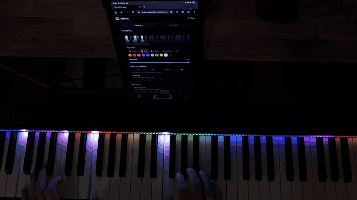
</p>

---

## Features

- 🎹 **Key lighting** - every key you play lights up instantly, in the colour you choose: solid, rainbow, gradient or random
- 🌈 **Backgrounds & 17 animations** - a solid, gradient or rainbow glow under the keys, and animations such as Aurora Borealis, Fireplace, Ocean Waves, Meteor Shower and Tetris. One can start by itself when nobody is playing
- 🎵 **Song learning** - the next keys light up and the app waits until you hit them. Follow the sheet music or falling notes, practise one hand while the app plays the other, slow the tempo down, loop a few bars, or listen to the song first
- 📚 **Song library** - about 800 songs by composer and difficulty, plus your own MIDI and MusicXML files
- 🎼 **Note learning** - note names, staff reading, ear training, chords, intervals and sequences, with levels and stats
- 🎯 **Scales & chords** - pick a key on the circle of fifths, see its key signature, and play or light up its scale on the strip
- 🥁 **Free Play** - your notes fly up on the screen as you play. Pick an instrument sound, or play the drum kit, drum pads and sequencer on the screen
- ⏺️ **Recording** - record your playing and play it back
- 🎮 **Piano games** - Reaction Game (3 modes), LED Keeper (20 levels), Piano Battle (2 players)
- 📱 **Web app** - control everything from your phone, tablet, or any browser, in English or Polish
- ➕ **...and more**

11 public domain demo songs are included (Canon in D, Für Elise, Moonlight Sonata, and more), with sheet music and falling notes. Your own MIDI/MusicXML files and the song library come with [Pro](#free-vs-pro).

---

## What it looks like

<p align="center">
  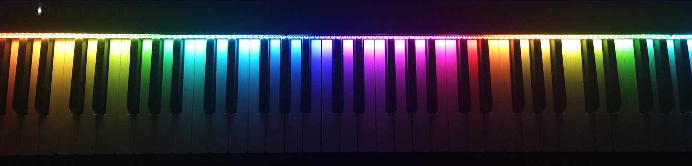
</p>

<p align="center">
  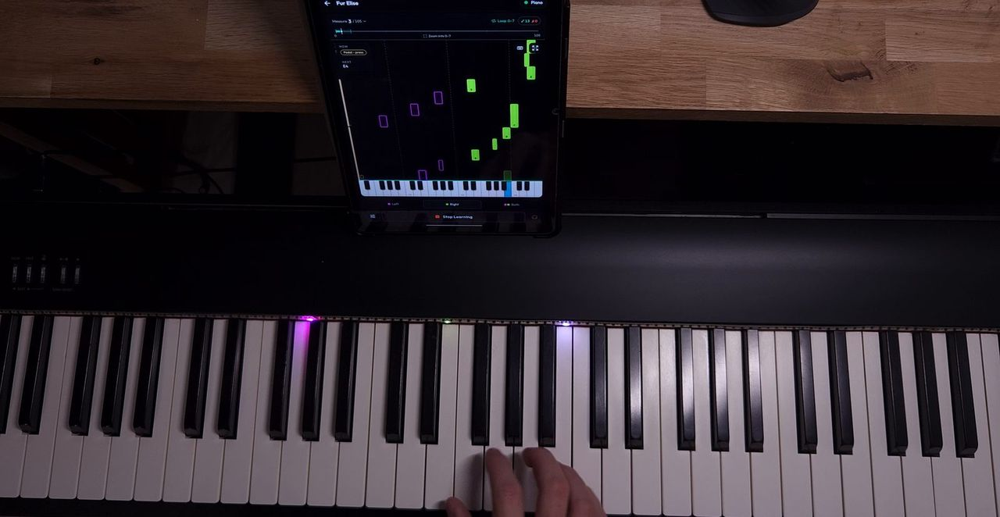
</p>

<table align="center">
<tr>
<td align="center" valign="top" width="33%">
  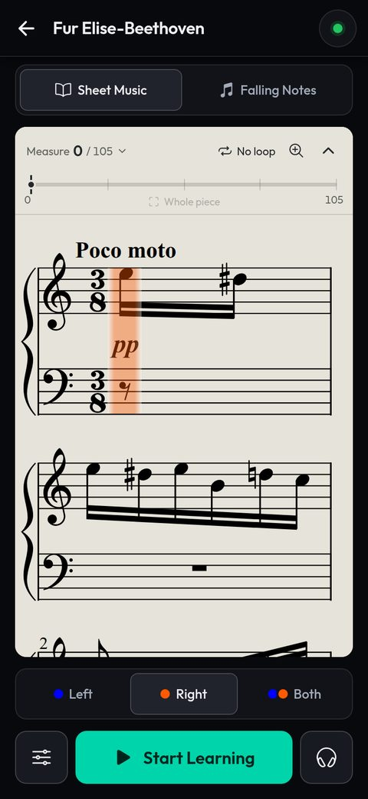<br>
  <sub>Learn a song from sheet music...</sub>
</td>
<td align="center" valign="top" width="33%">
  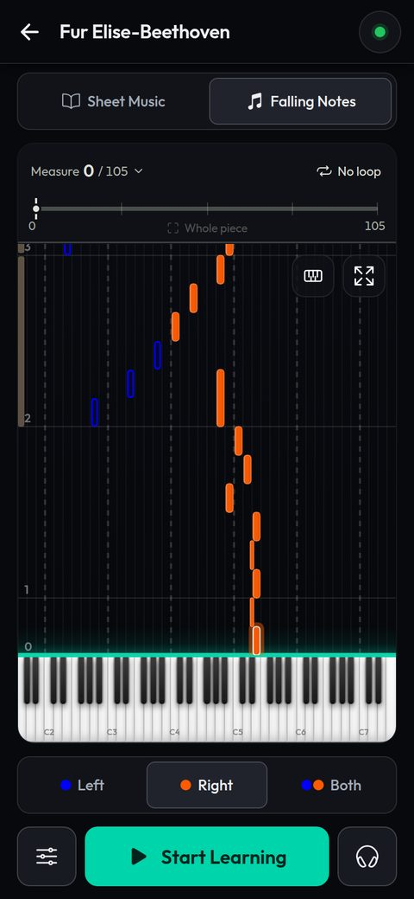<br>
  <sub>...or with falling notes</sub>
</td>
<td align="center" valign="top" width="33%">
  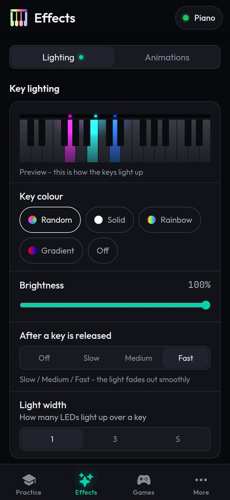<br>
  <sub>Key colours and light width</sub>
</td>
</tr>
<tr>
<td align="center" valign="top" width="33%">
  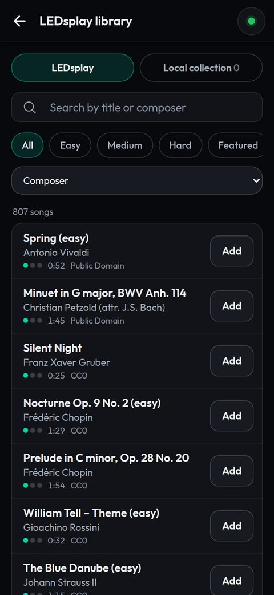<br>
  <sub>About 800 songs to add (Pro)</sub>
</td>
<td align="center" valign="top" width="33%">
  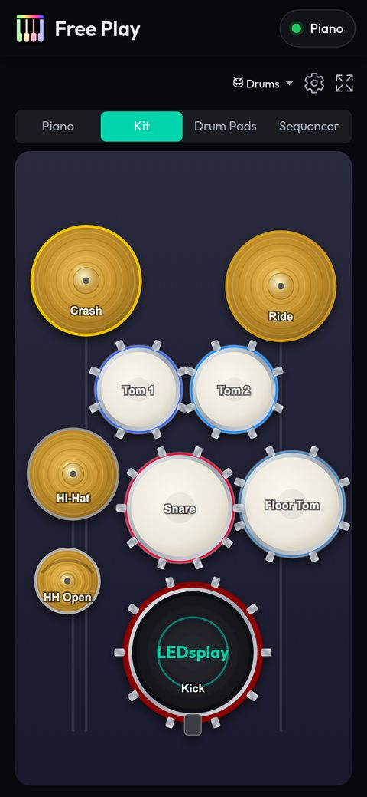<br>
  <sub>Free Play: drum kit, pads, sequencer (Pro)</sub>
</td>
<td align="center" valign="top" width="33%">
  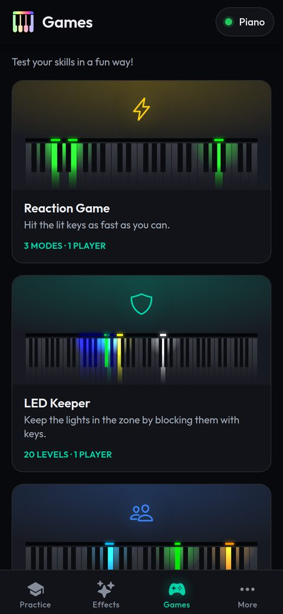<br>
  <sub>Piano games (Pro)</sub>
</td>
</tr>
</table>

<details>
<summary>More screenshots</summary>

### Practice
<p>
  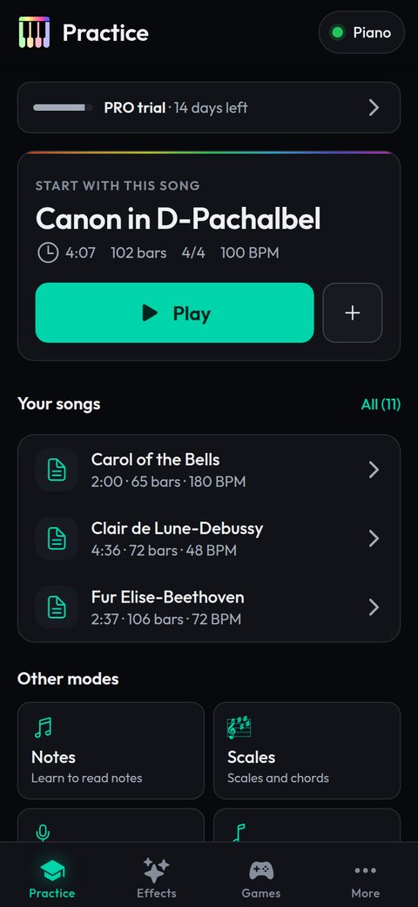
  &nbsp;
  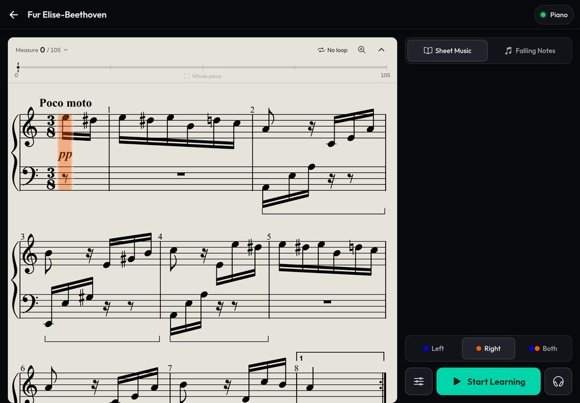
</p>

### Effects
<p>
  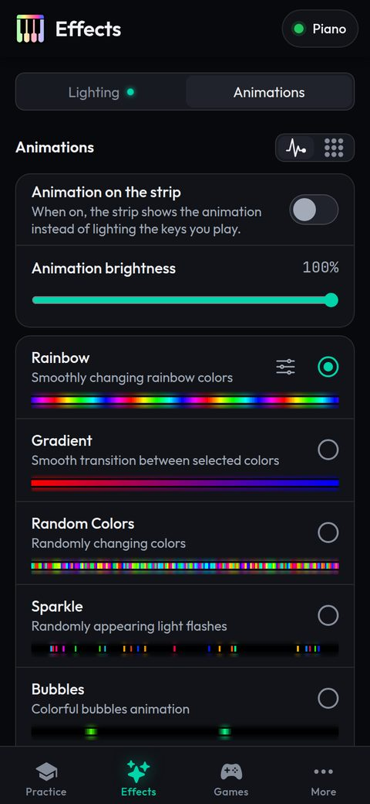
</p>

### Scales, Free Play & games
<p>
  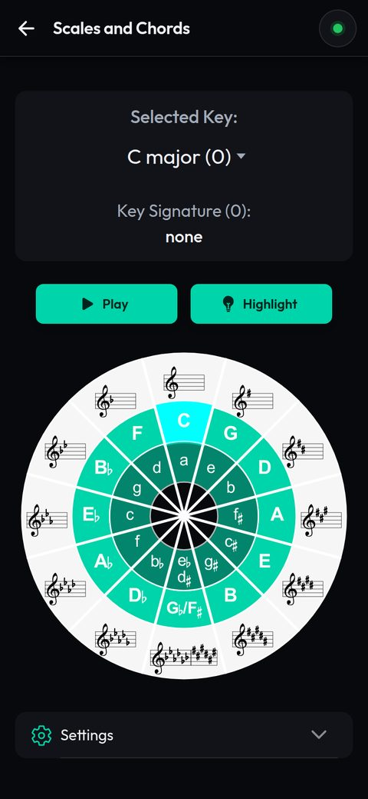
  &nbsp;
  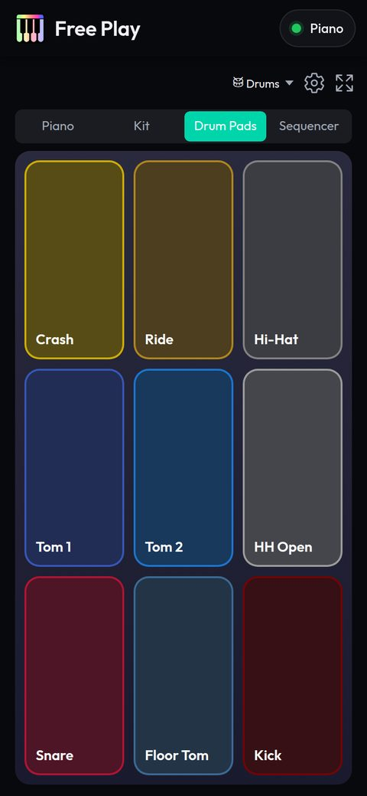
  &nbsp;
  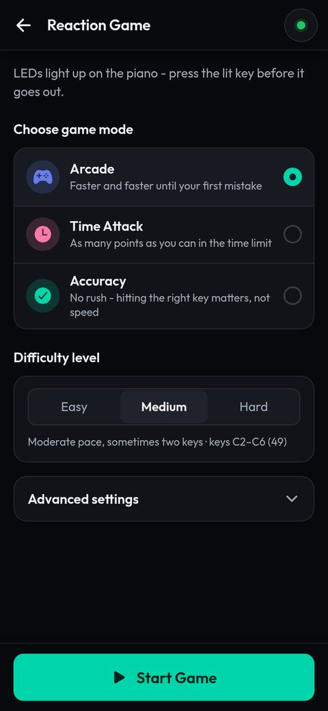
  &nbsp;
  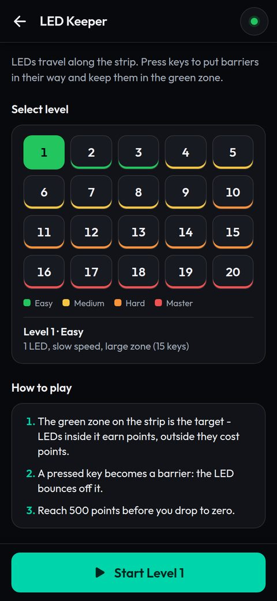
</p>

### System
<p>
  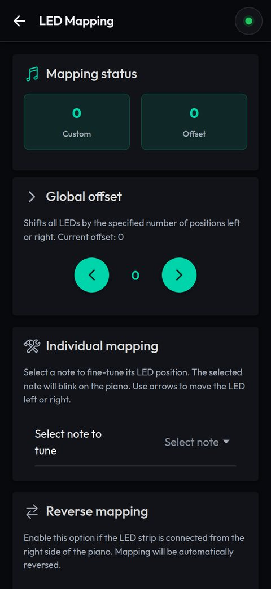
  &nbsp;
  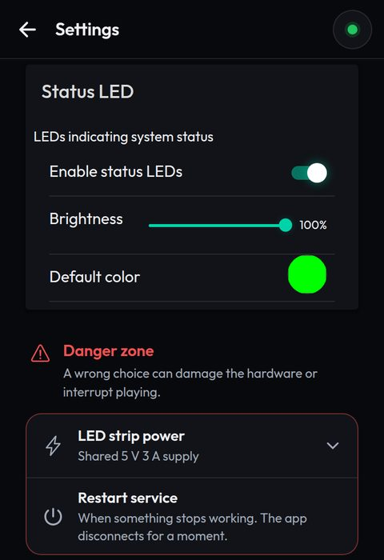
  &nbsp;
  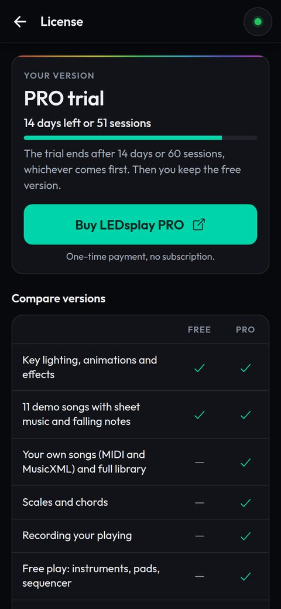
</p>

</details>

---

## Free vs Pro

The free version works forever - no time limit, no account needed.

| | Free | Pro ($9, one-time) |
|---|:---:|:---:|
| Real-time key lighting, backgrounds and all 17 LED animations | ✅ | ✅ |
| 11 demo songs to learn, with sheet music and falling notes | ✅ | ✅ |
| Your own songs (MIDI/MusicXML) | ❌ | ✅ |
| Song library (about 800 songs) | ❌ | ✅ |
| Note learning | ❌ | ✅ |
| Scales & chords | ❌ | ✅ |
| Recording your playing | ❌ | ✅ |
| Free Play: instruments, drum kit, pads, sequencer | ❌ | ✅ |
| Piano games | ❌ | ✅ |
| PCB Gerber files & 3D case STLs, downloaded with your purchase ([reference only](#build-with-custom-pcb-and-3d-case)) | ❌ | ✅ |
| All future features | ❌ | ✅ |

**One-time payment, no subscription.** LEDsplay runs entirely on your Raspberry Pi, with no cloud. One license works on up to 3 devices.

**[→ Get LEDsplay - $9 one-time](https://ledsplay.lemonsqueezy.com/checkout/buy/508ee6c2-dd59-4f1b-8153-ea8859449fe7)**

Not sure yet? [Install the free version](#installation) first: it comes with a 14-day trial of all Pro features, no card needed.

---

## What you need

<p align="center">
  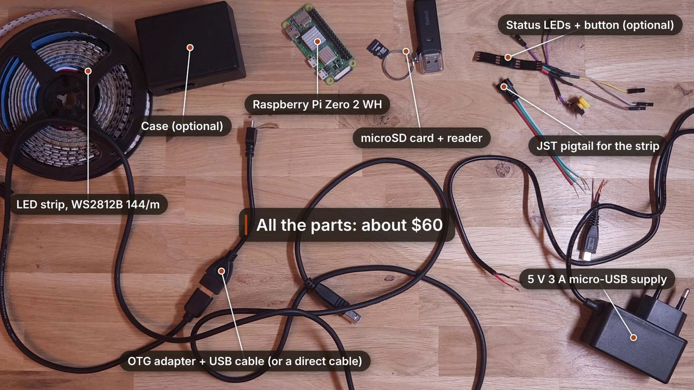
</p>

### Hardware

| Part | Details | Est. cost |
|------|---------|-----------|
| Raspberry Pi | Supported: **Zero 2 W**, **3B**, **3B+**, **4B**. Get the Zero 2 **WH**: its GPIO header is already soldered on. **Pi 5** isn't supported. [Example (SparkFun)](https://www.sparkfun.com/raspberry-pi-zero-2-w-with-headers.html) | $18–22 *(Zero 2 WH)* |
| microSD card | 8 GB or larger, Class 10 / A1 recommended | $5 |
| WS2812B LED strip | **5 V** version, 144 LEDs/m, individually addressable. Buy **2 m in a single piece**: a standard 88-key piano needs 177 LEDs (about 1.23 m), so one piece covers it with nothing to solder. The leftover is enough for the two optional status LEDs (those need wires soldered on). [Example (AliExpress)](https://www.aliexpress.com/item/1005007982624217.html) | $15–20 *(2 m)* |
| Digital piano | Any with **USB MIDI** output (tested on Roland FP-30) | - |
| USB cable | Piano side: usually USB-B. Pi side: micro USB on the Zero 2 W, USB-A on the others. For the Zero 2 W, the simplest is one micro-USB to USB-B cable ([example](https://www.aliexpress.com/item/32963023575.html)); a regular USB cable plus a micro-USB OTG adapter works too | $3–5 |
| Power supply | **5 V, 3 A minimum** (4 A for a 3B, 3B+ or 4B), with a plug that fits your Pi - one supply for both the Pi and the LED strip. See [Power & brightness](#power--brightness) | $5–15 |
| Wires | Female Dupont jumper wires for the GPIO header, a red/black wire pair (22 AWG or thicker) for the strip's power, a 3-pin JST-SM pigtail that fits the strip (many strips come with one), heat-shrink tubing | $3–8 |
| Case *(optional)* | Any small plastic project box - see [Case](#case-optional) - and double-sided tape or velcro to attach it to the piano | $2–3 |
| Status LEDs & standby button *(optional)* | Two WS2812B LEDs cut from the strip's leftover, or a small WS2812B LED stick; any push button on two jumper wires - see [Status LEDs and standby button](#status-leds-and-standby-button-optional) | $1–5 |
| Diffuser *(optional)* | White silicone channel that softens the LED dots, sized for your strip (e.g. T0515 for a 12 mm strip, Milk X Matte); 2 m for one piano. [Example (AliExpress)](https://www.aliexpress.com/item/1005008376388272.html) | $12–15 |

**Estimated total (without piano): about $50–75** for the required parts, with a Pi Zero 2 WH.

---

## Build options

The recommended build is plain wiring: the signal wires go straight into the GPIO header, and the LED strip takes its power from the supply cable, so its current never flows through the Pi. It's cheap and needs no special parts.

A custom PCB and 3D case also exist for a cleaner build - see [Build with custom PCB and 3D case](#build-with-custom-pcb-and-3d-case).

<p align="center">
  <a href="https://youtu.be/W2BOSH86alA"></a>
</p>

<p align="center"><em><a href="https://youtu.be/W2BOSH86alA">Watch the build video</a> (9 min): the parts, wiring without soldering, installing the software, WiFi setup and a tour of the app.</em></p>

---

### DIY build

> **A note from me:** I'm not an electronics engineer, so this wiring may not be the most elegant or textbook-correct setup. If you have ideas for improvements, I'd love to hear them - [open an issue](https://github.com/PabloCSScobar/ledsplay/issues).
>
> The **custom PCB** (see the other build below) was designed by a professional hardware engineer.

You can put this build together your own way - design your own enclosure or adapt a stock Pi case to fit your needs. The two status LEDs and the standby button are completely optional - the device and the app run perfectly without them.

You can build it without soldering. On the GPIO header, use female Dupont jumpers, or wrap each wire around its pin and secure it with heat-shrink tubing. Taking the strip's power from the supply cable takes two joints: twist them and cover them with heat-shrink, or solder them if you prefer - see [Wiring](#wiring). If you'd rather not solder the optional standby button, pick a model with screw terminals or pre-wired leads.

#### Wiring

One 5 V supply powers both the Pi and the LED strip. The strip takes its power from the supply cable before the plug: its +5 V and GND wires are joined to the cable's + and − wires. From there, the same cable goes on to the Pi's power socket (**PWR IN** on the Zero 2 W) and carries only the Pi's own current. The only wire between the strip and the Pi is the data wire.

<p align="center">
  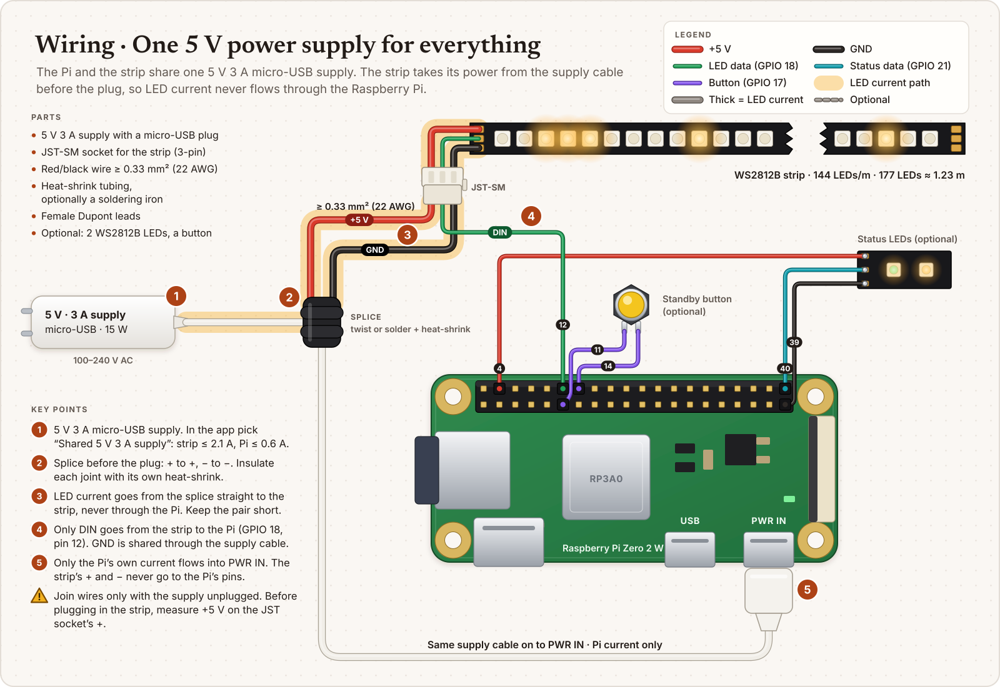
</p>

<table align="center">
<tr>
<td valign="top" width="50%">
  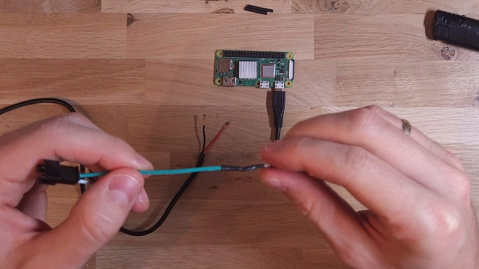<br>
  <em><strong>1. Data wire:</strong> twist a female Dupont jumper onto the strip's data wire and cover the joint with heat-shrink. Now the data wire ends in a plug for the GPIO header.</em>
</td>
<td valign="top" width="50%">
  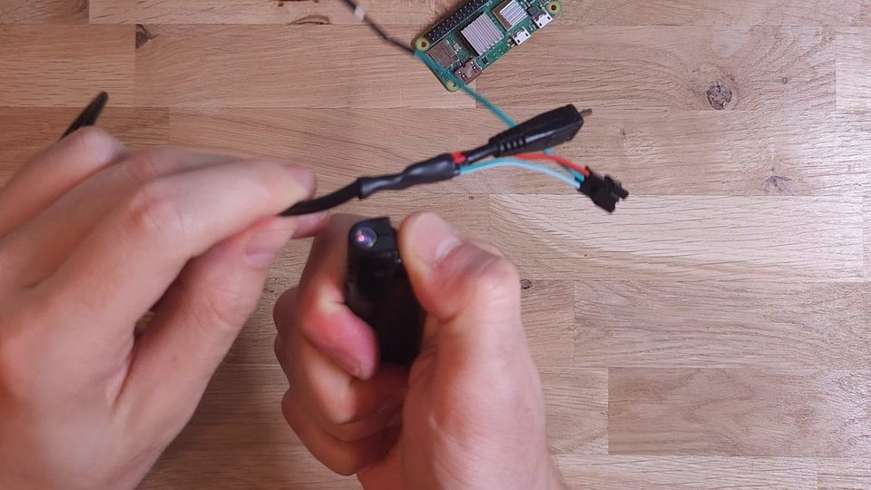<br>
  <em><strong>2. Strip power:</strong> join the strip's + and − to the supply cable's + and −, before the plug. Each joint gets its own heat-shrink tube, then one bigger tube goes over the whole splice.</em>
</td>
</tr>
<tr>
<td valign="top" width="50%">
  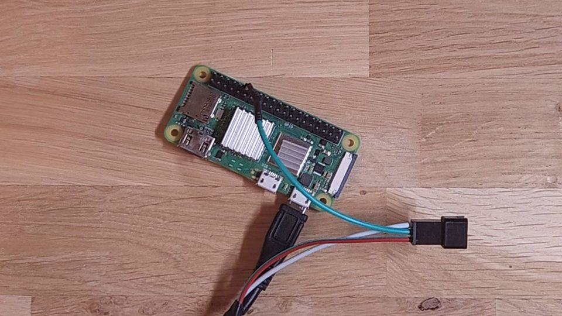<br>
  <em><strong>3. Plug into the Pi:</strong> the data plug goes onto pin 12 (GPIO 18). Then plug the strip into the JST connector.</em>
</td>
<td valign="top" width="50%">
  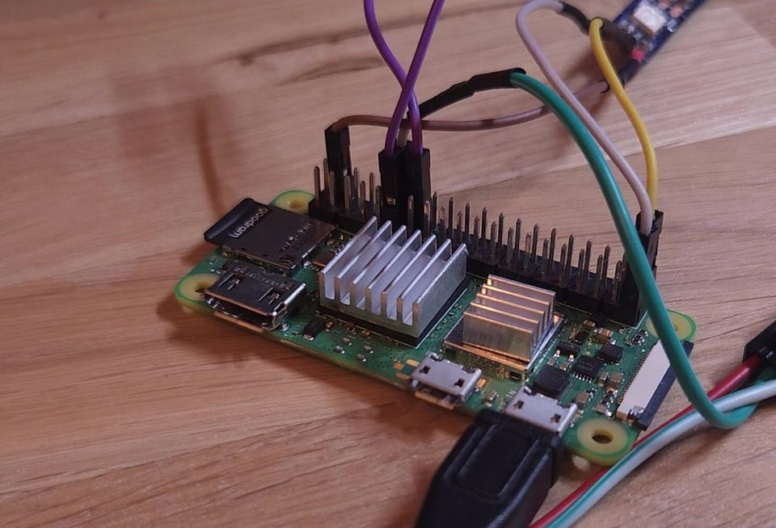<br>
  <em>All connections on the GPIO header, here with the optional status LEDs and standby button.</em>
</td>
</tr>
</table>

**Raspberry Pi pins:**

| Pi pin | Signal | Connect to |
|--------|--------|------------|
| **12** (GPIO 18) | LED strip data | strip DIN |
| **40** (GPIO 21) | status LEDs data *(optional)* | DIN of LED #1, then LED #1 DOUT → LED #2 DIN |
| **4** (5V) | status LEDs power *(optional)* | +5V of both status LEDs |
| **39** (GND) | status LEDs ground *(optional)* | GND of both status LEDs |
| **11** (GPIO 17) | standby button *(optional)* | one leg of the button |
| **14** (GND) | standby button *(optional)* | other leg of the button |

The strip's +5V and GND don't go to any Pi pin.

**Strip power** - from the supply cable:

| Goes to | Wire | Notes |
|---------|------|-------|
| LED strip +5 V / GND | red/black ≥ 0.33 mm² (22 AWG), as short as practical | join each wire to its conductor in the supply cable, + to +, − to −, and insulate each joint with its own heat-shrink tube |
| Pi power socket | the rest of the supply cable | carries only the Pi's current: about 0.6 A on a Zero 2 W, up to 1 A on a 3B or 4B |

- **Splice:** wire colours inside supply cables aren't standard - tell + from − with a multimeter, not by colour.
- **Joints:** soldering is optional. To skip it, slide a heat-shrink tube onto the wire first, strip about 1.5 cm of both ends, twist them tightly together and give the joint a firm tug: if it slips, twist it again. Then shrink the tube over it. A soldered joint or a lever connector (such as WAGO 221) works just as well.
- **Supply cable:** the part between the supply and the splice carries the strip's and the Pi's current together. If it's thin or long, the voltage drops at both - see [Before you power on](#before-you-power-on).
- **JST connector:** the strip's JST-SM contacts are rated 3 A. At the default power setting the strip draws at most 2.1 A, with the 4 A setting up to 3 A. If your strip has separate red/black power leads next to the connector, connect the power pair there and use the JST for data only.

Then plug your piano into a USB port on the Pi: on the Zero 2 W, the micro-USB port marked **USB**, not **PWR IN** (a cable with a USB-A plug goes through the OTG adapter). On the piano, use the USB port meant for a computer (labelled e.g. **USB COMPUTER** or **USB TO HOST**).

#### Before you power on

Do all wiring with the supply unplugged. Then check with a multimeter:

1. **Polarity:** with the strip unplugged and the supply plugged in, you should read 5.0–5.25 V between + and − in the strip's JST socket. A negative reading means + and − are swapped.
2. **Full load:** plug everything in and set a white background at full brightness. The strip input must stay at 4.75 V or more and the Pi must not reboot. If the voltage drops, use a shorter or thicker cable between the supply and the splice, or pick a lower setting in **Settings → Danger zone → LED strip power**.
3. **Heat:** after 10 minutes of a bright effect, the splice, the JST connector and the Pi's power plug may be warm, never hot.

#### Status LEDs and standby button (optional)

<p align="center">
  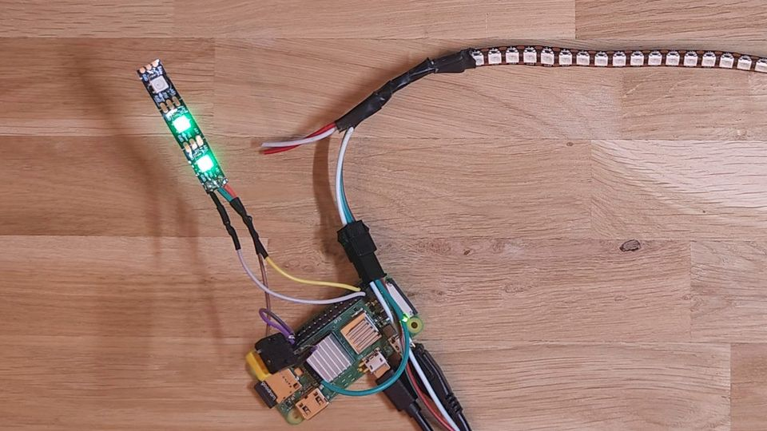
</p>

- **Status LEDs:** two WS2812B LEDs show the system state at a glance - see [Status LEDs](#status-leds). Cut two LEDs from the strip's leftover, or use a small WS2812B LED stick. Connect them to pins **4** (5V), **39** (GND) and **40** (GPIO 21).
- **Standby button:** any push button on two jumper wires, connected to pins **11** (GPIO 17) and **14** (GND). Press it to put LEDsplay to sleep (lights off), press it again to wake it.

#### Case (optional)

Any small project box works: drill holes for the strip lead, USB and power. For a 3D-printed case with a custom PCB, see [Build with custom PCB and 3D case](#build-with-custom-pcb-and-3d-case).

<table align="center">
<tr>
<td valign="top" width="33%">
  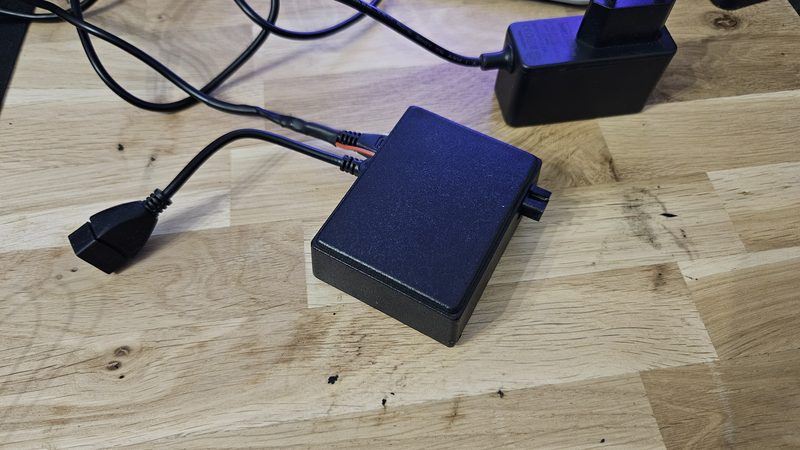<br>
  <em>Pi Zero 2 W in a generic plastic enclosure - holes drilled in the sides for the LED strip socket, USB MIDI, and power.</em>
</td>
<td valign="top" width="33%">
  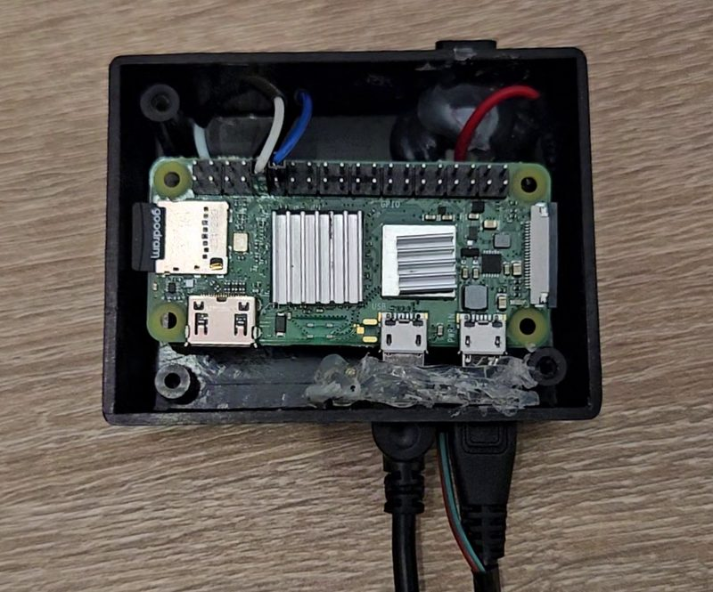<br>
  <em>Inside view of the same stock case - just the Pi, no PCB needed.</em>
</td>
<td valign="top" width="33%">
  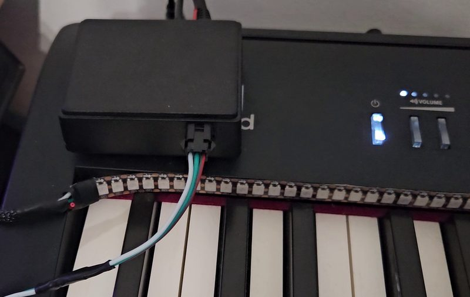<br>
  <em>The stock-case build mounted on the piano next to the LED strip.</em>
</td>
</tr>
</table>

#### Option: separate LED supply

The strip can get its own 5 V LED supply, while the Pi keeps its own supply. You don't need this for normal use - see [Power & brightness](#power--brightness).

<p align="center">
  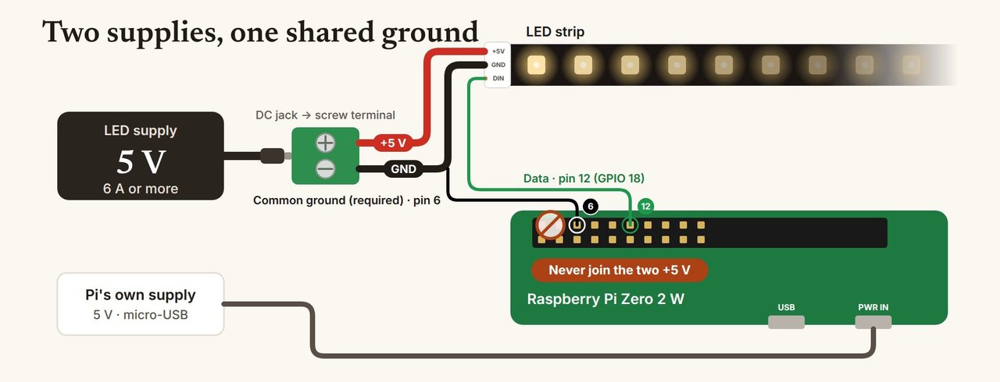
</p>

- **Strip power:** run +5 V and GND from the LED supply to the strip, for example through a DC jack with screw terminals.
- **Common ground:** the strip's GND also goes to a GND pin on the Pi (e.g. pin 6), next to the data wire on pin 12. Without it the data signal doesn't work.
- **Never join the two +5 V.** The strip's supply and the Pi's supply only share the ground.
- **In the app:** pick **Separate 5 V 6 A strip supply** in **Settings → Danger zone → LED strip power**. It lets the strip draw up to 5 A, more than the JST connector's 3 A, so connect the LED supply to the strip's separate red/black power leads and use the JST only for data and GND. If your strip has only the JST, pick **Shared 5 V 4 A supply** instead: it keeps the strip at 3 A.

---

### Build with custom PCB and 3D case

A custom PCB and 3D-printed case for the Pi Zero 2 W, with almost no wiring: you only swap the strip's end connector for a 3-pin JST plug that fits the PCB socket. The Pi goes onto the PCB, the PCB into the case, the lid on top.

The PCB Gerber files and case STLs come with Pro as a download with your purchase, mainly as a reference if you want to build your own version. Ordering a single assembled PCB from a manufacturer is not cost-effective due to fixed setup fees - DIY wiring (see above) is the simplest and cheapest way to build this.

<p align="center">
  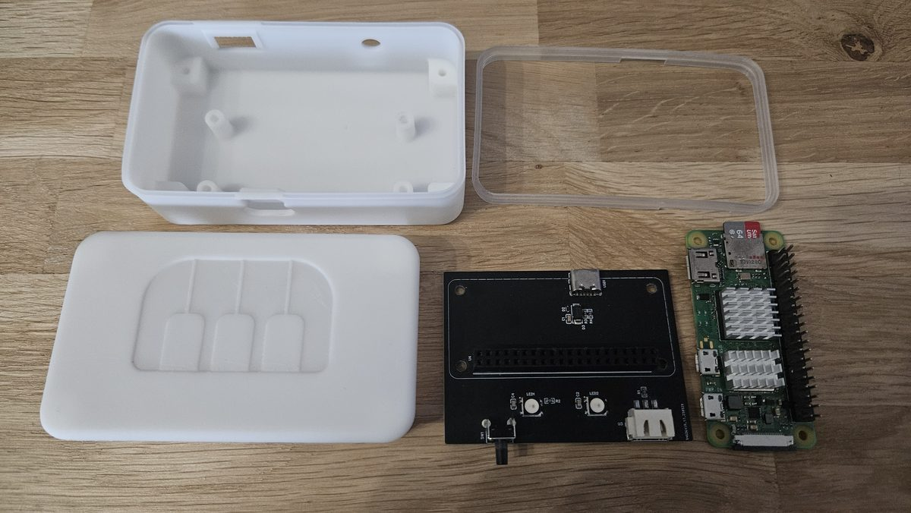
</p>

<p align="center"><em>The pieces: 3D-printed case parts, custom PCB, Raspberry Pi Zero 2 W.</em></p>

<table align="center"><tr>
<td valign="top">
  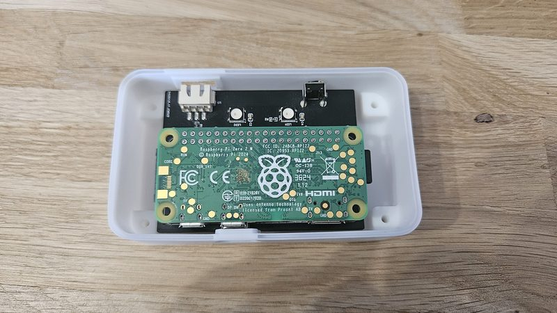<br>
  <em>Pi snaps into the PCB, which sits inside the case.</em>
</td>
<td valign="top">
  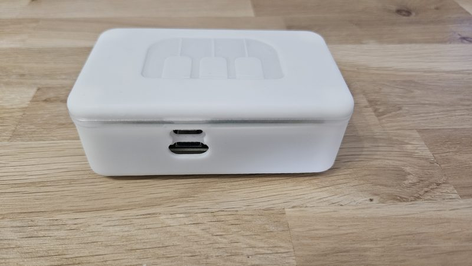<br>
  <em>Closed case with a piano-key relief on the lid.</em>
</td>
</tr></table>

<p align="center">
  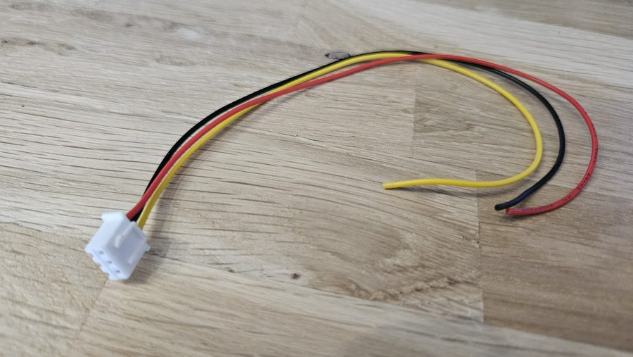
</p>

<p align="center"><em>To connect the LED strip to the custom PCB, its end has to be terminated with a 3-pin JST plug.</em></p>

<p align="center">
  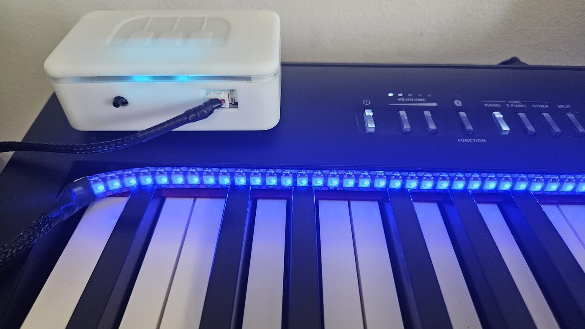
</p>

<p align="center"><em>Installed on a Roland FP-30 - LED strip running across the keys.</em></p>

---

## Installation

There are two ways to install LEDsplay. The pre-built image is the easiest: no terminal needed.

---

<!-- The ids keep old links (tutorial, video description) working: the two options used to be numbered the other way round. -->
### <a id="option-2---pre-built-image"></a>Option 1 - Pre-built image (recommended)

Download a ready-to-use system image - Raspberry Pi OS Lite with LEDsplay already installed.

**1. Download the image** from the [Releases page](https://github.com/PabloCSScobar/ledsplay/releases): open the latest release and, under **Assets**, download the file ending in **`.img.xz`**, about 700 MB. The small `.tar.gz` file is the app update package, not a system image - Imager can't write it. Once LEDsplay runs, you can [update it](#updating) to the newest version from the app.

**2. Flash it** using [Raspberry Pi Imager](https://www.raspberrypi.com/software/): choose your Pi model, then under **Operating System** scroll down to **Use custom** and pick the downloaded `.img.xz` file. Pick your SD card - check its size, it will be erased. No customisation is needed: click **Write** and confirm. Writing and verifying take about 5 minutes; Imager ejects the card when it's done.

**3. Boot the Raspberry Pi:** put the card in the Pi and plug in the power. The strip stays dark at first; after a minute without playing it starts a screensaver animation. The first boot takes a minute or two before the hotspot is up; if you fitted the status LEDs, they pulse blue when it's ready. While the screensaver runs they cycle green, blue and purple instead, and pulsing yellow means the piano isn't detected yet: you can go on to the next step either way.

**4. Connect to the LEDsplay hotspot** from your phone, tablet, or PC:

| | |
|---|---|
| **SSID** | `LEDSplay-Setup` |
| **Password** | `ledsplay` |

**5. Configure WiFi:** open **http://ledsplay.local** in your browser (if it doesn't load, open **http://10.42.0.1**). The welcome screen takes you there with **Choose WiFi network**; later you'll find it under the **More** icon at the bottom → **WiFi Network**. Select your home WiFi network, type its password and tap **Connect**. After a few seconds the `LEDSplay-Setup` hotspot will turn off and the Pi will join your network. Switch your phone back to your home WiFi too.

If the Pi can't join (for example, a wrong password), the `LEDSplay-Setup` hotspot comes back within a minute or two - connect to it and try again. You can switch networks later the same way. After a restart, the Pi tries your saved networks first and turns the hotspot on only when none of them is in range.

**6. Done.** On your home WiFi, open **http://ledsplay.local** - you're in. The welcome screen checks that LEDsplay hears your piano: press any key, and an LED should light up above it. If you fitted the status LEDs, they turn green; pulsing yellow means the piano isn't detected - check its USB cable.

---

### <a id="option-1---script-install"></a>Option 2 - Script install
Install on a [supported Raspberry Pi](#hardware).

**1. Flash Raspberry Pi OS Lite (32-bit)** onto a microSD card. You can use [Raspberry Pi Imager](https://www.raspberrypi.com/software/) or any other tool; in Imager it's under **Raspberry Pi OS (other) → Raspberry Pi OS Lite (32-bit)**.

> **Use the current 32-bit release (Debian 13 "Trixie").** LEDsplay won't start on the 64-bit OS or on the older "Legacy" (Bookworm) release.

If using Raspberry Pi Imager, open the settings and configure:
- **Hostname:** `ledsplay` - this lets you reach the Pi at `ledsplay.local`
- **Username:** `pi`
- **WiFi credentials** - so the Pi connects to your network on first boot
- **Enable SSH** - so you can log in remotely without a monitor

**2. Boot the Pi and connect via SSH:**

```bash
ssh pi@ledsplay.local
# or use the IP address assigned by your router
```

If SSH shows `REMOTE HOST IDENTIFICATION HAS CHANGED` (you flashed this card before), run `ssh-keygen -R ledsplay.local` and connect again.

**3. Run the setup script:**

```bash
curl -fsSL https://raw.githubusercontent.com/PabloCSScobar/ledsplay/main/setup.sh | sudo bash
```

This downloads the latest release from GitHub, installs all dependencies, and configures the system. **On Raspberry Pi Zero 2 W, setup takes about 5 minutes.**

**4. Reboot** if prompted.

**5. Done.** Open **http://ledsplay.local** in your browser to access the app.

<details>
<summary>What the installer does</summary>

- Downloads the latest release from GitHub
- Installs system dependencies (Python 3, GPIO libraries, MIDI tools)
- Sets up a Python virtual environment at `/opt/ledsplay/`
- Enables SPI and turns off the Pi's built-in audio, which would interfere with the LED signal
- Pre-generates MusicXML cache for bundled demo songs
- Creates a systemd service (`ledsplay.service`) that starts on boot
- Full log at `/var/log/ledsplay-setup.log`

</details>

---

## Fitting the strip

### Measure and cut the strip

A standard 88-key piano needs 177 LEDs: about 1.23 m of a 144 LEDs/m strip. Lay the strip along the keys to see how much you need.

Then unplug the strip, count 177 LEDs from the input end (the arrows on the strip point away from it) and cut right after LED 177, through the middle of the copper pads.

<p align="center">
  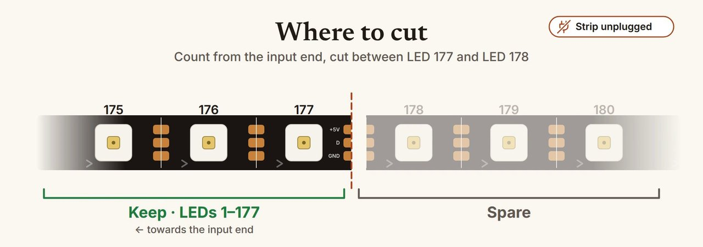
</p>

### Diffuser (optional)

A white silicone diffuser spreads the light and softens the dots; a clear sleeve only protects the strip. For the size, see the [parts list](#hardware).

<p align="center">
  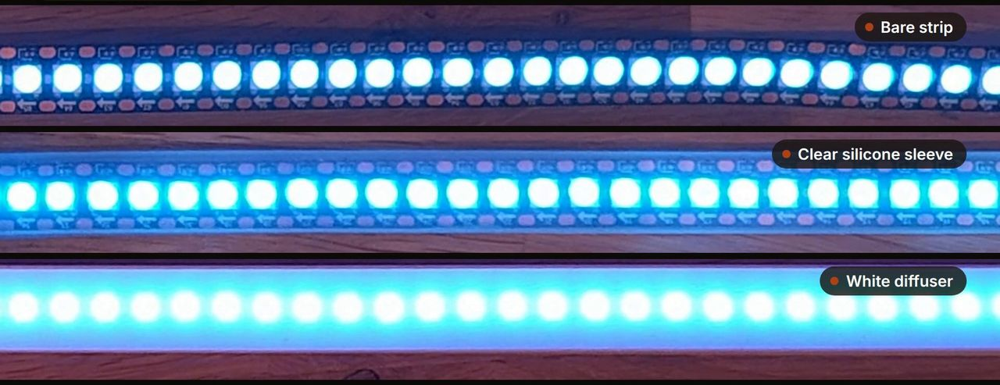
</p>

<p align="center"><em>Top to bottom: bare strip, clear silicone sleeve, white diffuser.</em></p>

### Put the strip on the piano

Lay the strip (in its diffuser, if you use one) along the back of the keys, with its input end at the lowest key on the left. Before you stick it down, play a few keys across the keyboard and shift the strip until the lights roughly line up with them; fine-tune the rest in [LED mapping](#led-mapping). If the lead to the Pi has to come out on the right, turn on **Reverse mapping**.

### LED mapping

If the lights don't line up with the keys, open **More → LED Mapping**:

- **Global offset:** the arrows shift all LEDs left or right.
- **Individual mapping:** a key lights the wrong LED? Select that note: its LED blinks on the piano. Move it left or right with the arrows, then tap **Confirm**.
- **Reverse mapping:** if the strip's input end is on the right side of the piano, turn this on.

---

## Activating your license

After purchasing, you'll receive a license key by email from Lemonsqueezy.

**1.** Open the app at **http://ledsplay.local**, tap the **More** icon at the bottom, then go to **License**.

**2.** Paste your license key and tap **Activate**.

**3.** Done - all Pro features unlock immediately, no restart needed.

Each license can be active on **up to 3 devices** at once.

<details>
<summary>Transferring your license to a new device</summary>

If you get a new Pi, reflash your SD card, or swap in a different Pi, your license needs to be moved over manually - the activation is tied to that specific Pi's hardware ID, and reflashing wipes it.

**On the old device:** open **More → License** and tap **Transfer license**. This deactivates the license on that Pi and frees up a slot.

**On the new device:** activate the same license key as usual (see steps above).

</details>

---

## Your own song collection

Have a whole folder of sheet music? Keep it on LEDsplay and browse it in the app: in your songs tap **Add New Song → LEDsplay library → Local collection**. Search, filters and the list stay fast even with thousands of files.

- **Folder on LEDsplay:** `ledsplay-collection` in the home folder of the user LEDsplay is installed for, normally `/home/pi/ledsplay-collection`. The exact path is shown at the bottom of the **Local collection** tab. Put your files there over the network, or upload them in the app.
- **Uploading in the app:** **Upload folder** sends a whole folder with its subfolders (desktop browser). **Upload files** works on phones and tablets too.
- **Subfolders become categories:** `Classical/Chopin/Nocturne.mxl` shows up under **Classical / Chopin** in the **Folder** filter.
- **Formats:** MusicXML (`.musicxml`, `.xml`), compressed MusicXML (`.mxl`) and MIDI (`.mid`, `.midi`). Other files are skipped.
- **Practising:** tap **Add** next to a song to put it in your songs, then **Practice**. Only the songs you add appear in your song list, so the collection can stay as big as you like.

Files copied straight to the folder show up within 30 seconds. Uploading and adding songs are Pro features (included in the trial).

---

## Updating

Updates are available in the app: **More → Settings → Check for updates**.

It installs the latest release from this repository and rolls back automatically if the update fails.

<details>
<summary>Manual update</summary>

```bash
sudo /opt/ledsplay/venv/bin/python3 /opt/ledsplay/updater.py update
```

</details>

---

## Power & brightness

A WS2812B LED draws up to 60 mA at full white, so the 177-LED strip could pull more than 10 A. LEDsplay keeps it far below that in two ways:

- **Brightness caps:** keys max 30%, background max 25%. Even at these caps, the whole strip white would draw about 3.4 A.
- **Current limit:** before each frame goes out, LEDsplay estimates its current from the colours. If the frame needs more than your power supply can give, the whole strip dims just enough to fit and brightens back within half a second. Only the brightness changes, never the colours.

Tell LEDsplay how the strip is powered in **Settings → Danger zone → LED strip power**:

| Setting | Strip limit | Use it for |
|---|---:|---|
| Shared 5 V 3 A supply *(default)* | 2.1 A | the [wiring above](#wiring) with a 3 A supply |
| Shared 5 V 4 A supply | 3 A | the same wiring with a 4 A supply |
| Separate 5 V 6 A strip supply | 5 A | a dedicated LED supply just for the strip - see [Option: separate LED supply](#option-separate-led-supply) |

If you're not sure, pick the lower setting. Too low only dims an almost all-white strip. Too high lets the strip draw more than your supply gives: with a bright picture the Pi may reboot, and the supply and wires get hot. That's why the app asks you to confirm before it raises the limit.

For a shared supply, the limit is the supply's rating minus 0.6 A for a Pi Zero 2 W, minus a 10% margin. At the default 2.1 A, playing, coloured backgrounds and the rainbow animation stay below the limit. Only an almost all-white strip dims, to about 18% instead of 25–30%. With a 4 A supply and its setting, an all-white background shines at full brightness.

Thanks to the current limit, an ordinary 5 V 3 A phone or Raspberry Pi supply is enough for a Pi Zero 2 W. A **Pi 3B, 3B+ or 4B** needs about 1 A itself: use a 5 V 4 A supply with the default "Shared 5 V 3 A supply" setting.

**Never power the strip from the Pi's 5V pins:** take its power from the supply cable. The Pi Zero 2 W has no fuse between PWR IN and the 5V pins, and a micro-USB socket's power contacts are rated about 1.8 A.

The Pi Zero series has no low-voltage warning. If the voltage sags, nothing shows up in the logs - the Pi just reboots. If it reboots when the strip lights up brightly, check the supply and the wiring.

### Troubleshooting

| Symptom | Likely cause | Fix |
|---|---|---|
| Strip stays dark | a splice joint that doesn't conduct, or + and − swapped | check the joints; with the strip unplugged, measure 5 V on + in the JST socket |
| Random colours, flicker, glitches on the first LEDs | a loose or long data wire: the Pi's 3.3 V data is at the edge of what the strip accepts | check the data wire on pin 12 and keep it short |
| Pi reboots when the strip lights up brightly | a power setting above your supply, a weak supply, or a thin supply cable | the setting that matches your supply in Settings → Danger zone → LED strip power; a 5 V supply of at least 3 A with a short, thick cable |
| An almost all-white strip looks dimmer than expected | the current limit keeps it within your supply | expected; with a bigger supply, pick its setting in Settings → Danger zone → LED strip power |
| Far end of the strip looks yellowish on white | voltage drop along the strip | a thicker or shorter power pair |
| A connector or wire gets hot | contact or wire too small for the current | ≥ 0.33 mm² (22 AWG) pair and solid joints (redo any loose one); use the strip's power leads instead of the JST |
| First LED dead or stuck | the strip was plugged in or rewired while powered | unplug the supply before you rewire anything or plug in the strip |
| Nothing lights up when you play, status LEDs pulse yellow | the piano isn't detected | switch the piano on; check the cable: the piano's port for a computer, the Pi's port marked **USB** (not **PWR IN**) |
| The lights are shifted from the keys | the LED mapping doesn't match your piano | More → LED Mapping - see [LED mapping](#led-mapping) |

---

## Service management

```bash
sudo systemctl status ledsplay.service     # Check status
sudo systemctl restart ledsplay.service    # Restart
sudo journalctl -u ledsplay.service -f     # View logs
```

---

## Status LEDs

LEDsplay supports 2 small indicator LEDs (GPIO 21, pin 40) to show system state at a glance. They are optional - the app works without them. Wiring: [Status LEDs and standby button](#status-leds-and-standby-button-optional).

| Colour / animation | Meaning |
|---|---|
| 🟢 Green (solid) | Ready - everything OK |
| 🔵 Blue (pulsing) | WiFi hotspot `LEDSplay-Setup` active - waiting for network setup |
| 🟡 Yellow (pulsing) | No piano (MIDI device) detected - check its USB cable |
| 🟢🔵🟣 Cycling | LED animation or screensaver running |
| ⚫ Off | Status LEDs disabled in settings, or LEDsplay in standby |

When more than one applies, the animation cycle wins, then yellow, then blue.

Colour and brightness can be customised in **Settings → Status LED** in the app.

The optional standby button (GPIO 17, pin 11) puts LEDsplay to sleep: the strip and the status LEDs go dark. Press it again to wake it.

---

## Feedback & support

Found a bug or have an idea? [Open an issue](https://github.com/PabloCSScobar/ledsplay/issues) - I read every one. New features and fixes ship regularly.

Need support for another language? Open an issue - I'd love to add it. The app currently supports **English** and **Polish**.

---

## License

LEDsplay is proprietary software. The free version has no time limit; see [Free vs Pro](#free-vs-pro).

<sub>Built with Python (Flask + Socket.IO) and Angular + Ionic.</sub>
